<div align="center">

<h1>SekaiPop</h1>

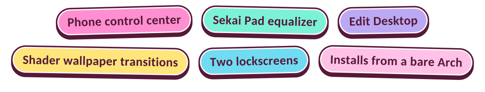

<br>

[Showcase](#showcase) &nbsp;|&nbsp; [What makes it different](#different) &nbsp;|&nbsp; [Requirements](#requirements) &nbsp;|&nbsp; [Installation](#installation) &nbsp;|&nbsp; [Keybinds](#keybinds) &nbsp;|&nbsp; [Troubleshooting](#troubleshooting)

<br>

<div align="left">

> ⚠️ **Warning: this is a passion project, and it is heavily vibe-coded.**
>
> I designed and directed SekaiPop myself: the visuals, the UI, how everything should animate and how everything should behave. Claude wrote most of the code to make that possible, so expect rough edges and bugs.

</div>

<br>

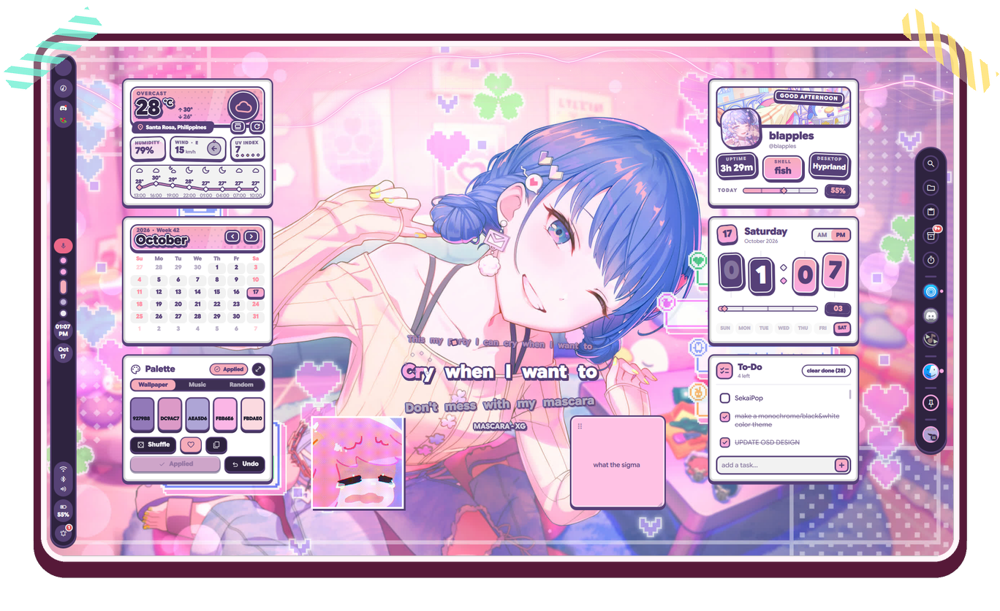

<sub>Clock, weather, calendar, to-do, palette, user card, sticky notes, lyrics and custom images. Every widget is draggable, resizable and optional.</sub>

</div>

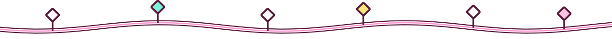

<h2 id="showcase">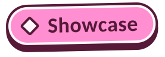</h2>

<table>
<tr>
<td width="50%" valign="top">
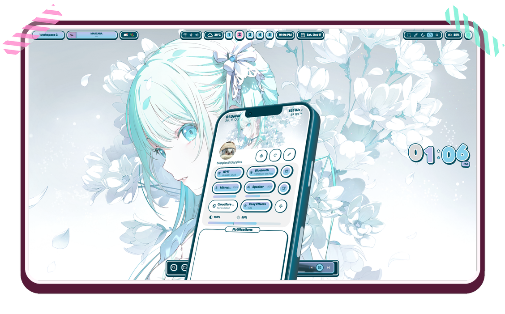
<br><b>Quick Panel: the control center is a phone</b><br>
Wi-Fi, Bluetooth, mic, speaker, brightness, night light, easy effects and notifications sit on a 2.5D phone that bounces up from the bottom of the screen. A new notification makes it rise just far enough to show it.
</td>
<td width="50%" valign="top">
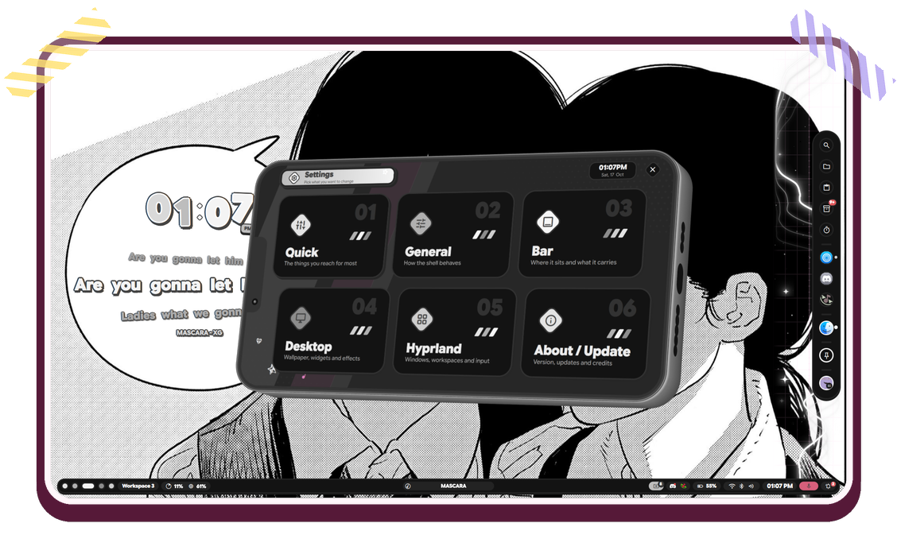
<br><b>Settings: flip the phone sideways</b><br>
Settings opens by rotating the Quick Panel phone into landscape. Six pages: Quick, General, Bar, Desktop, Hyprland and About / Update. Shown here in the Monochrome theme.
</td>
</tr>
<tr>
<td width="50%" valign="top">
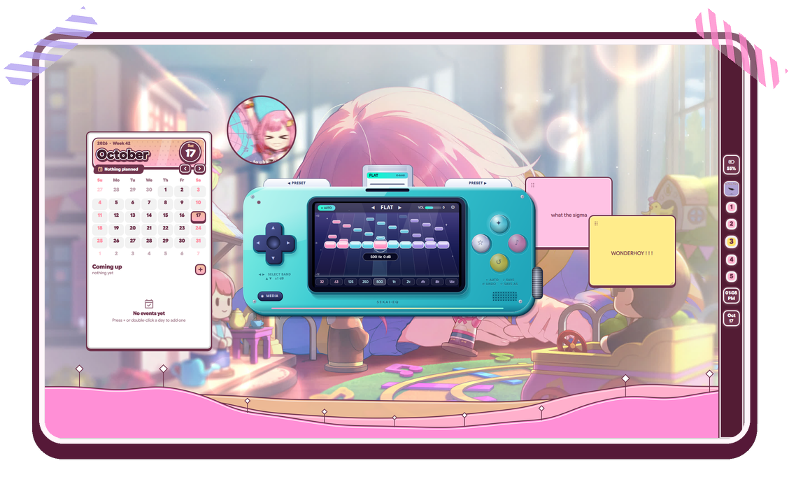
<br><b>Sekai Pad: the equalizer is a handheld console</b><br>
A 10-band EQ (EasyEffects) with a D-pad for picking a band, face buttons for save, undo and auto, and preset cartridges you slot in at the top.
</td>
<td width="50%" valign="top">
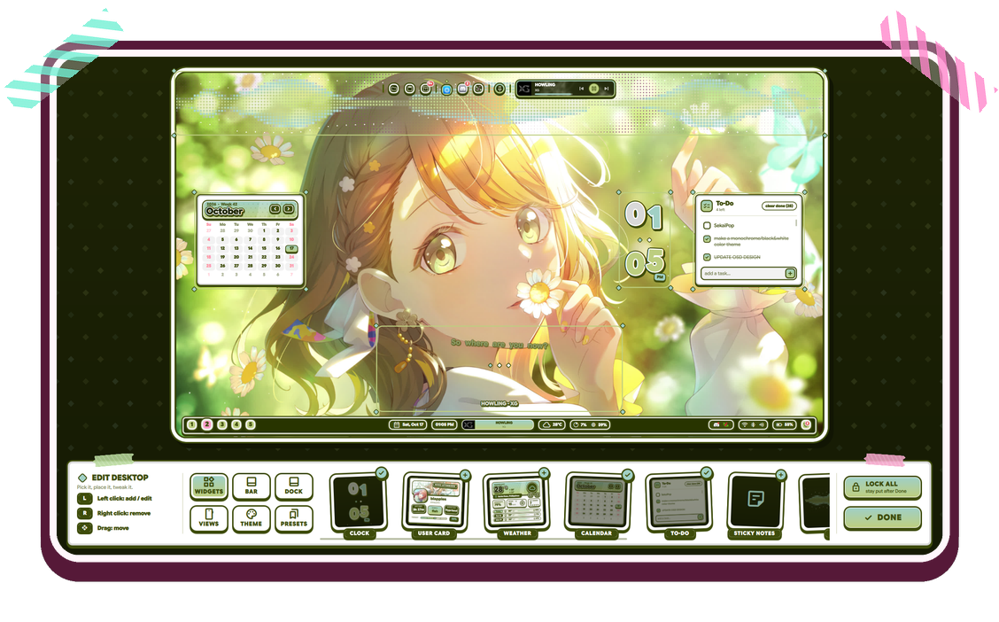
<br><b>Edit Desktop: rearrange it like a scrapbook</b><br>
Press <kbd>Super</kbd> + <kbd>Shift</kbd> + <kbd>E</kbd>. Left click adds or edits, right click removes, drag moves. Widgets, bar, dock, views, themes and presets all live here.
</td>
</tr>
</table>


<h2 id="different">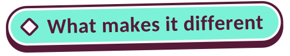</h2>

Most shells pick one look and theme it. SekaiPop starts from a single design language, applies it to everything, and adds a few ideas of its own.

<table>
<tr>
<td width="50%" valign="top"><b>One block, everywhere</b><br>Every pill, key, card and popup is an outline, a thin cream ring, a fill and a hard shadow straight down, like a keycap that sinks when you press it. Nothing looks bolted on.</td>
<td width="50%" valign="top"><b>The shell is a phone</b><br>The Quick Panel, Settings and the app launcher are phones. Settings is the same phone rotating into landscape. Things pop up when they turn on and get swallowed when they turn off, instead of fading.</td>
</tr>
<tr>
<td valign="top"><b>Sekai Pad</b><br>An equalizer designed as hardware: a D-pad, face buttons, a screen with the live curve, and preset cartridges.</td>
<td valign="top"><b>Edit Desktop</b><br>A full-screen layout editor built from the same blocks, with tabs for Widgets, Bar, Dock, Views, Theme and Presets.</td>
</tr>
<tr>
<td valign="top"><b>Presets that survive updates</b><br>Wearing an old preset doesn't drag in widgets that were added later. Lockscreen style, folder paths and other machine-specific choices are left alone.</td>
<td valign="top"><b>Themes with personality</b><br>Six character-unit themes (Virtual Singer, Leo/need, MORE MORE JUMP!, Vivid BAD SQUAD, Wonderlands×Showtime, Nightcord at 25:00), Monochrome, Wallpaper (matugen) and a Custom palette, each in Light, Dark and Darker. They reach window borders, GTK, Qt and KDE colours, the terminal and a Vencord (Discord) theme.</td>
</tr>
<tr>
<td valign="top"><b>Shader wallpaper transitions</b><br>Ring, Iris, Star (it spins), Blocks, Flash, Fade and Random. The bands cover the whole desktop, then reveal the new wallpaper, in your theme's colours. The same transition plays into and out of the lockscreen.</td>
<td valign="top"><b>Two lockscreens</b><br>Gacha, and Calendar: a poster with three frames cut from your wallpaper, the clock as four keycaps, a month card and two-press Restart / Shut down keys. Hold <kbd>Ctrl</kbd> and Enter becomes Sleep. While locked, the desktop sleeps: widgets are freed, cava and video wallpapers stop, and everything wakes up one by one on unlock.</td>
</tr>
<tr>
<td valign="top"><b>A dock with real tools</b><br>Search, Files (Music, Pictures, Videos, Documents, Trash, with video thumbnails), Clipboard, Timer, a media card with seeking, and the Shelf: a drag-and-drop tray where items become polaroids, vinyls, books, folders and notes held with tape.</td>
<td valign="top"><b>Music that feels alive</b><br>A media pill with a live wave, a cava visualizer widget, and a lyrics widget that asks several providers (LyricsPlus, NetEase, LRCLIB, QQ Music, Kugou), picks the best one per song, highlights word by word and has a source picker.</td>
</tr>
<tr>
<td valign="top"><b>Discord voice</b><br>A bar pill and popup showing who is in the call, who is speaking, mute and deafen, through a small Vencord companion plugin. Optional; it needs the official Discord client patched with the standalone Vencord installer, plus <code>git</code>, <code>node</code> and <code>pnpm</code>. Run <code>sekaipop/scripts/discordVoice/vencord-companion/install.sh</code> to add the plugin.</td>
<td valign="top"><b>Configure without config files</b><br>Drag screens around a to-scale Displays layout and set resolution, scale and refresh rate. Set keyboard layouts with a bar switcher. Open a cheatsheet that builds itself from your Hyprland bind descriptions. Tune night light, gamma and brightness, and get a reload popup that shows shell errors.</td>
</tr>
<tr>
<td valign="top"><b>A full desktop</b><br>On-screen display, polkit prompt, notifications, screen snip (region, OCR to clipboard, Google Lens, screen record, colour picker), Game Mode, Focus Mode, Overview, on-screen keyboard and a welcome tour. Bar and dock work on any edge in four styles: Float, Straight, Transparent and Capsule.</td>
<td valign="top"><b>An installer for a bare system</b><br><code>./install.sh</code> turns a minimal Hyprland install into the complete desktop: packages, fonts, services, groups, the shell and a ready Hyprland config, with backups and a one-command restore.</td>
</tr>
</table>


<h2 id="requirements">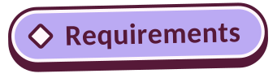</h2>

| Need | Notes |
|---|---|
| **Arch-based distro** (Arch, CachyOS, EndeavourOS) | The installer uses `pacman` and the AUR |
| **Hyprland 0.55+** | The config is **Lua** (`hyprland.lua`); older versions can't read it |
| **Quickshell** | `quickshell` or `quickshell-git` |
| **Qt 6.7+** | Shaders ship built for Qt 6.12. On older Qt the installer rebuilds them once (needs `qt6-shadertools`) |
| **A normal user with `sudo`** | Don't run the installer as root |
| **An AUR helper** (`yay` or `paru`) | The installer can build `yay-bin` for you if you have none |

> [!IMPORTANT]
> GPU drivers are **never** touched by the installer. Install your own (especially NVIDIA) before you start.

<details>
<summary><b>Core packages</b> (the shell can't start without these)</summary>
<br>

`hyprland` `quickshell` `qt6-base` `qt6-declarative` `qt6-multimedia-ffmpeg` `qt6-svg` `qt6-imageformats` `qt6-wayland` `qt6-shadertools` `dbus` `polkit` `mesa` `pipewire` `wireplumber` `pipewire-pulse` `libpulse` `networkmanager` `bluez` `bluez-utils` `upower` `power-profiles-daemon` `libnotify` `wl-clipboard` `jq` `curl` `git` `xdg-utils` `xdg-user-dirs` `fontconfig` `python` `python-numpy` `ttf-material-symbols-variable`

</details>

<details>
<summary><b>Feature packages</b></summary>
<br>

| For | Packages |
|---|---|
| Themes | `matugen` `adw-gtk-theme` `dconf` `glib2` `xorg-xrdb` |
| Music | `cava` `easyeffects` |
| Screenshots, OCR, recording | `grim` `slurp` `swappy` `tesseract` `tesseract-data-eng` `imagemagick` `wf-recorder` `ffmpeg` `hyprpicker` |
| Clipboard, emoji, typing | `cliphist` `wtype` |
| Night light, brightness | `hyprsunset` `brightnessctl` `ddcutil` |
| Dialogs, terminal | `zenity` `kitty` |
| Wi-Fi / Bluetooth "Advanced" buttons | `plasma-nm` `kde-cli-tools` `blueman` |
| Sounds, updates | `libcanberra` `sound-theme-freedesktop` `pacman-contrib` |
| Media keys | `playerctl` |

</details>

<details>
<summary><b>Desktop layer</b> (skip with <code>--no-desktop-layer</code> if you already have a desktop)</summary>
<br>

`xorg-xwayland` `xdg-desktop-portal` `xdg-desktop-portal-hyprland` `xdg-desktop-portal-gtk` `gvfs` `adwaita-icon-theme` `noto-fonts` `noto-fonts-cjk` `noto-fonts-emoji` `ttf-jetbrains-mono-nerd` `gnome-keyring` `libsecret` `pipewire-alsa`, plus a file manager (Dolphin on KDE, Thunar otherwise) and `qt6ct` where nothing else themes Qt.

The portals are what make screen sharing work in Discord, browsers and OBS.

</details>

<details>
<summary><b>Optional</b> (<code>--with-optional</code>)</summary>
<br>

`python-aubio` `songrec` (song recognition), `mpvpaper` (video wallpapers), `nwg-displays`, `hypridle`, `nodejs` `pnpm` (Vencord plugin build), `cloudflare-warp-bin`

</details>

<details>
<summary><b>Fonts and services</b></summary>
<br>

**Fonts:** Google Sans Flex (the installer fetches it into `~/.local/share/fonts`) and Material Symbols Rounded for icons.

**Services the installer enables:** `NetworkManager`, `bluetooth`, `upower`, `power-profiles-daemon`, and the PipeWire user services (`pipewire`, `pipewire-pulse`, `wireplumber`). You are also added to the `video` group.

</details>


<h2 id="installation">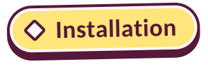</h2>

### 1. Install

```bash
curl -fsSL https://raw.githubusercontent.com/Blapples/SekaiPop/main/get.sh | bash
```

That is the whole install. It downloads SekaiPop, then does three jobs:

1. **Dependencies:** packages (repos and AUR), Google Sans Flex, services, groups.
2. **The shell:** copied to `~/.config/quickshell/sekaipop` (an older copy is kept as `.bak-<time>`).
3. **Hyprland:** a ready Lua config in `~/.config/hypr` (keybinds, rules, autostart, idle lock) and a `monitors.lua` made for the screens connected right now. Inside a running Hyprland it picks the highest refresh rate your screen offers at its preferred size.

> [!WARNING]
> Run it as your normal user, not root. It calls `sudo` itself where needed.

Want to look first? Add `--dry-run`: it prints everything it would do and changes nothing.

```bash
curl -fsSL https://raw.githubusercontent.com/Blapples/SekaiPop/main/get.sh) | bash -s -- --dry-run
```

Options go after the command (see [Installer options](#installer-options)), for example `--yes` or `--hypr merge`.

<details>
<summary>Prefer to clone it yourself?</summary>

```bash
git clone https://github.com/Blapples/SekaiPop.git
cd SekaiPop
./install.sh --dry-run      # look first
./install.sh                # install
```

```
install.sh   install-deps.sh   check-deps.sh
hypr/        Hyprland (Lua) config
sekaipop/    the shell itself
```

</details>

### 2. Start it

Log out and back in, choosing the plain **Hyprland** session (**not** "uwsm"). The shell starts by itself. Inside an already running Hyprland the installer offers to reload and start it for you.

### 3. Check everything

```bash
curl -fsSL https://raw.githubusercontent.com/Blapples/SekaiPop/main/get.sh | bash -s -- --check
```

It is read-only: it lists what is installed and what is missing, and changes nothing.

### Installer options

| Option | What it does |
|---|---|
| `--dry-run` | Show everything, change nothing |
| `--yes` | No questions |
| `--hypr full` | Install the preconfigured Hyprland config (default on a new setup) |
| `--hypr merge` | **Keep your config**, only add a small `sekaipop_session` file |
| `--hypr skip` | Don't touch Hyprland at all |
| `--no-deps` | Only copy files, install no packages |
| `--rice DIR` | Install a different copy of the `sekaipop` folder |
| `--restore` | Put back the Hyprland config backed up by the last run |
| `-- <options>` | Pass options on to `install-deps.sh` |

`install-deps.sh` extras (pass them after `--`): `--core-only`, `--with-optional`, `--no-desktop-layer`, `--gpu amd|intel|nvidia|skip`, `--ddc`, `--file-manager dolphin|thunar|none`, `--no-update`, `--no-aur`.

```bash
./install.sh --hypr merge                          # I already have a Hyprland config
./install.sh -- --with-optional --gpu amd          # everything, AMD GPU
./install.sh --yes -- --core-only                  # bare minimum, no questions
```

### Safety

- Your old Hyprland config is moved to `~/.config/hypr.sekaipop-backup-<time>`, **never deleted**. `./install.sh --restore` brings it back.
- Your `monitors.lua`, `workspaces.lua`, `sekaipop_overrides.lua` and `custom/` folder are carried over.
- `monitors.lua` is **never shipped**. It is generated for your screens, so a config written for someone else's monitors can't give you a black screen.
- A mistake in any config file is written to `~/.cache/sekaipop/hypr-errors.log`; the other files still load.

### Updating

Run the install command again. Settings and state live in `~/.local/state/sekaipop`, so your choices are kept. If you cloned the repo instead, `git pull` and run `./install.sh` again.

### Your own changes

Edit the files in `~/.config/hypr/custom/` (`keybinds.lua`, `rules.lua`, `variables.lua`, `env.lua`, `execs.lua`, `general.lua`). They load after the defaults and are never overwritten. Give a keybind a description like `"Apps: My thing"` and the cheatsheet lists it.


<h2 id="keybinds"></h2>

Press <kbd>Super</kbd> + <kbd>/</kbd> any time for the full list, grouped.

| Keys | Action |
|---|---|
| <kbd>Super</kbd> (tap) or <kbd>Super</kbd> + <kbd>A</kbd> | Apps (launcher phone) |
| <kbd>Super</kbd> + <kbd>N</kbd> | Quick Panel |
| <kbd>Super</kbd> + <kbd>Tab</kbd> | Overview |
| <kbd>Super</kbd> + <kbd>I</kbd> | Settings |
| <kbd>Super</kbd> + <kbd>/</kbd> | Cheatsheet |
| <kbd>Super</kbd> + <kbd>K</kbd> | On-screen keyboard |
| <kbd>Super</kbd> + <kbd>M</kbd> | Equalizer (Sekai Pad) |
| <kbd>Super</kbd> + <kbd>G</kbd> | Game Mode |
| <kbd>Super</kbd> + <kbd>Shift</kbd> + <kbd>E</kbd> | Edit Desktop |
| <kbd>Super</kbd> + <kbd>Shift</kbd> + <kbd>F</kbd> | Focus Mode |
| <kbd>Ctrl</kbd> + <kbd>Super</kbd> + <kbd>T</kbd> | Wallpaper picker |
| <kbd>Ctrl</kbd> + <kbd>Super</kbd> + <kbd>Alt</kbd> + <kbd>T</kbd> | Random wallpaper |
| <kbd>Ctrl</kbd> + <kbd>Super</kbd> + <kbd>Shift</kbd> + <kbd>T</kbd> | Theme picker |
| <kbd>Ctrl</kbd> + <kbd>Super</kbd> + <kbd>Shift</kbd> + <kbd>D</kbd> | Dark mode toggle |
| <kbd>Ctrl</kbd> + <kbd>Super</kbd> + <kbd>R</kbd> | Restart the shell |
| <kbd>Super</kbd> + <kbd>L</kbd> | Lock |
| <kbd>Super</kbd> + <kbd>Shift</kbd> + <kbd>S</kbd> | Screen snip |
| <kbd>Super</kbd> + <kbd>Shift</kbd> + <kbd>X</kbd> | Character recognition (OCR) to clipboard |
| <kbd>Super</kbd> + <kbd>Shift</kbd> + <kbd>A</kbd> | Google Lens |
| <kbd>Super</kbd> + <kbd>Shift</kbd> + <kbd>R</kbd> | Record region |
| <kbd>Super</kbd> + <kbd>V</kbd> / <kbd>Super</kbd> + <kbd>.</kbd> | Clipboard history / emoji |

Volume and brightness keys go through the shell's on-screen display.


<h2 id="troubleshooting">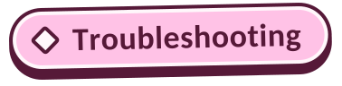</h2>

| Problem | Try |
|---|---|
| Shell doesn't start | Run `qs -c sekaipop log`, and make sure you logged into the plain **Hyprland** session, not uwsm |
| Black screen after install | `./install.sh --restore`, then read `~/.cache/sekaipop/hypr-errors.log` |
| Icons are missing | Install `ttf-material-symbols-variable`, then `fc-cache -f` |
| Shaders or transitions don't draw | Qt older than 6.12 needs the shaders rebuilt: `bash ~/.config/quickshell/sekaipop/shaders/compile-shaders.sh` (needs `qt6-shadertools`) |
| Hyprland rejected part of the config | `hyprctl configerrors` shows what it refused to load |
| Something is missing | Run `./check-deps.sh`; it lists every missing package and QML module |


<h2 id="credits">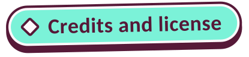</h2>

> [!CAUTION]
> The region selector's **search** action uploads the cropped screenshot to `uguu.se` before opening Google Lens. Don't use it on anything private.

SekaiPop is built on other people's work, and I'm grateful to all of them.

**The foundation**

- **[end4](https://github.com/end-4)** and [dots-hyprland](https://github.com/end-4/dots-hyprland) (Illogical Impulse): the foundation of this whole shell. The Hyprland configuration in `hypr/` is adapted from it, the installer follows the idea of `./setup install`, and the Anti-Flashbang shaders are copied unchanged (GPL-3.0). The cheat sheet, the Overview and the way Settings is organised also take after it.
- **[pCtrade](https://github.com/pctrade)** (end4-pC): the inspiration for how customizable this shell is, and for his support along the way. The `aurora`, `dots`, `mirror` and `ring` audio visualizers are ported from his work.
- **[p3dro](https://github.com/P3DROVFX)**'s fork of Illogical Impulse: the Discord Voice service the bar pill and popup are ported from.
- **[ilyamiro](https://github.com/ilyamiro)** and his Serpentium shell: the equalizer engine behind the Sekai Pad. The 10-band EasyEffects backend (`equalizer.sh`) came to SekaiPop through the pC fork, and the welcome screen follows the structure of his `Start.qml`. The handheld-console design of the Sekai Pad is SekaiPop's own.

**Projects it uses**

- [Quickshell](https://quickshell.org) and [Hyprland](https://hyprland.org), which it runs on.
- [matugen](https://github.com/InioX/matugen) by InioX, for colours drawn from the wallpaper.
- Material Discord by CapnKitten and system24 by refact0r, the base of the Discord theme.
- [emojibase](https://github.com/milesj/emojibase) (MIT), for the launcher's emoji data.
- Material Symbols (icons) and Google Sans Flex (text).
- [hyprland-scroll-overview](https://github.com/yayuuu/hyprland-scroll-overview) by yayuuu, an optional plugin the shell can use.
- [Open-Meteo](https://open-meteo.com) for the weather, and LRCLIB, LyricsPlus, NetEase Cloud Music, QQ Music and Kugou for lyrics.

Because it includes GPL-3.0 code, **this repository is distributed under GPL-3.0**. See [LICENSE](LICENSE).

Character themes and names are fan references to *Project SEKAI COLORFUL STAGE! feat. Hatsune Miku*. This is an unofficial fan project, not affiliated with SEGA, Colorful Palette or Crypton Future Media. Wallpapers shown in the screenshots belong to their original artists.


