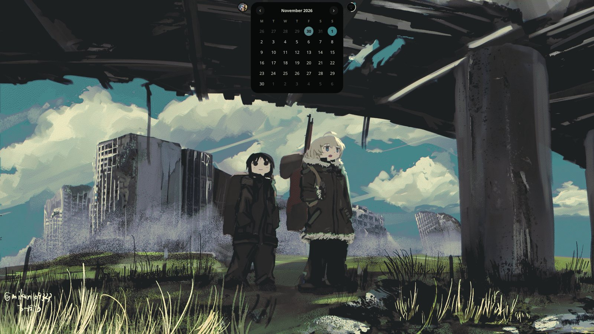
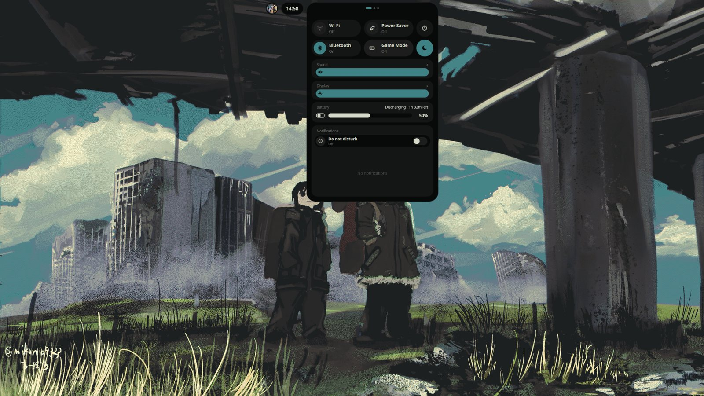
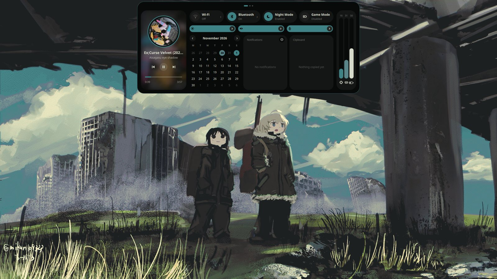
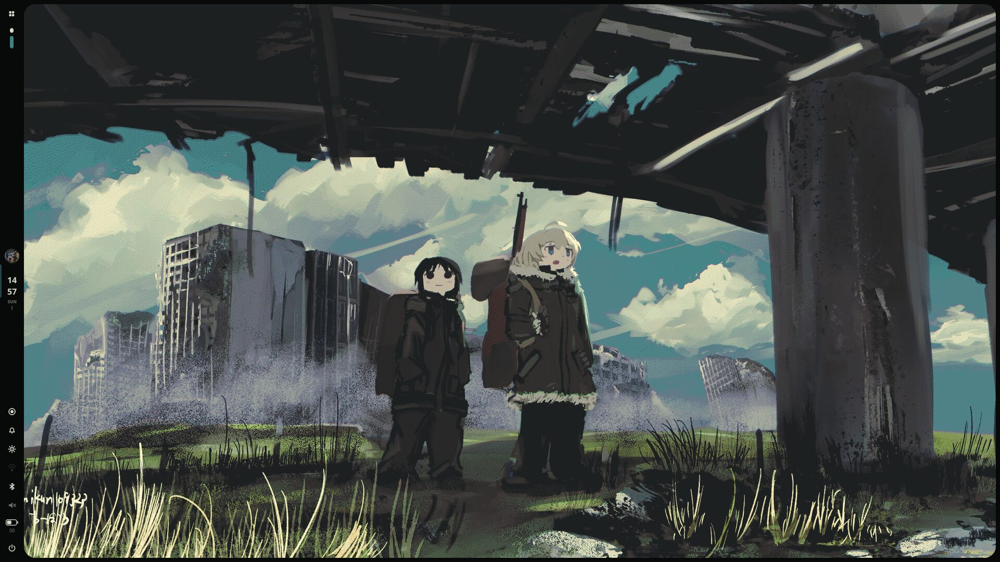
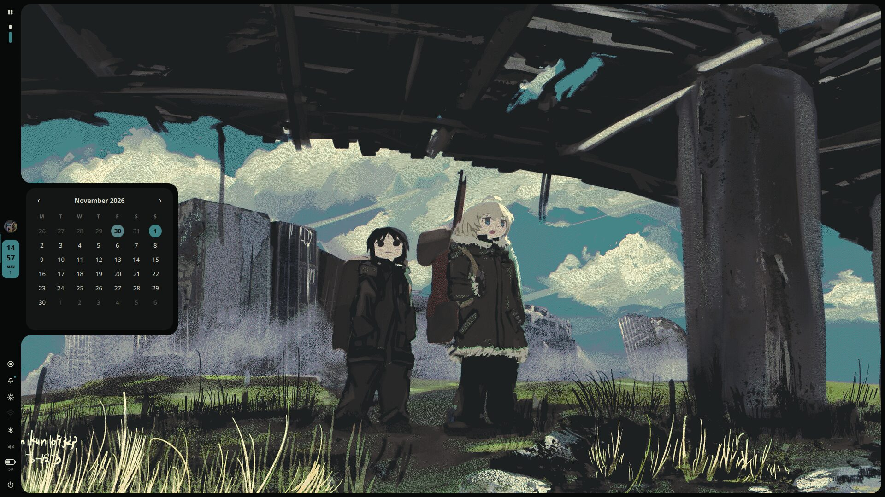
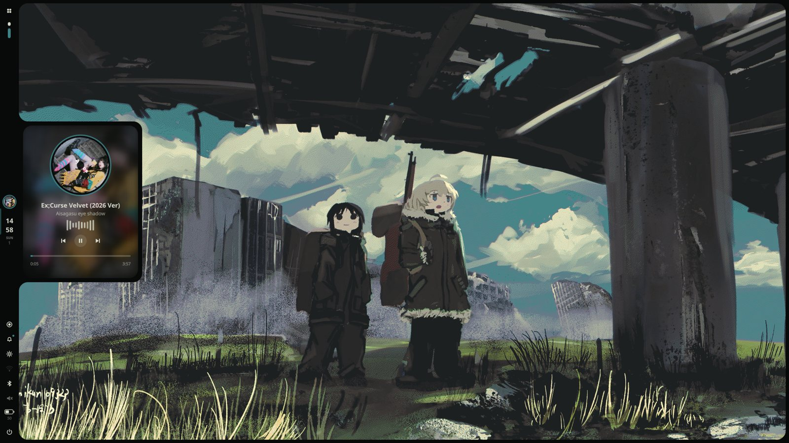
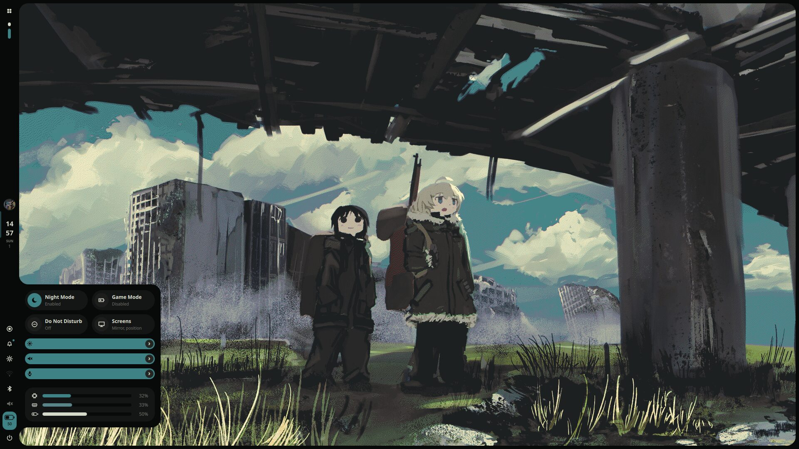
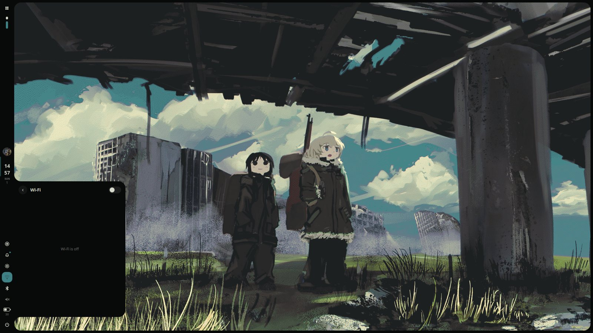
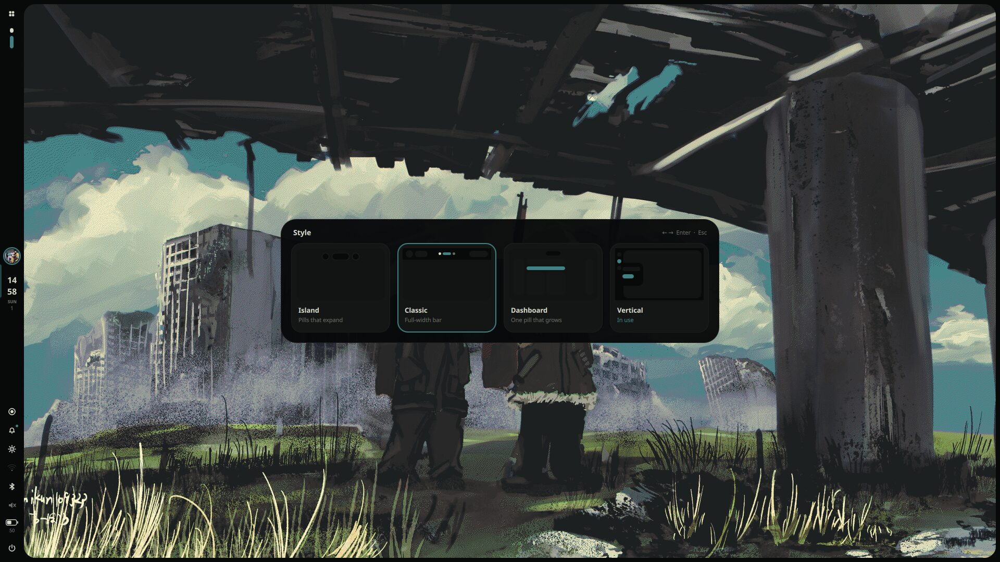
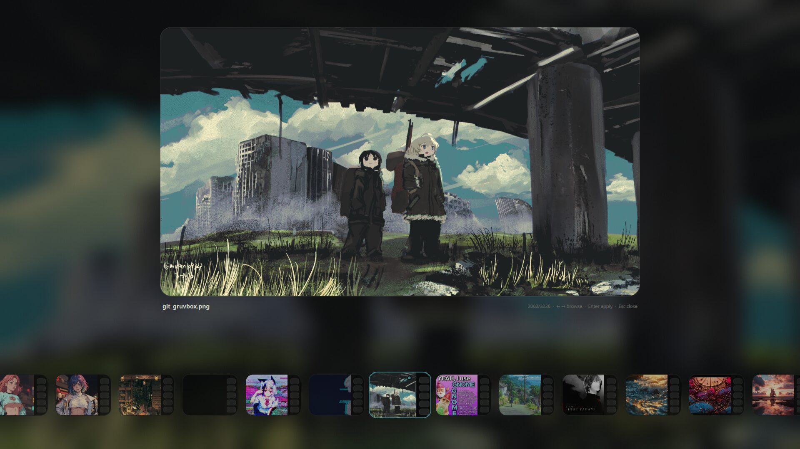

# quickshell-dots

[🇬🇧 English](README.md) · 🇮🇹 Italiano

Una shell desktop completa fatta con [Quickshell](https://quickshell.org), per **niri** e **Hyprland**.
Un'unica installazione, le stesse scorciatoie e gli stessi quattro stili su tutti e due i compositor.

> ## ⚠️ Leggi qui prima di aprire una issue
>
> Questo **non è un progetto per tutti**. L'ho fatto perché mi andava, e funziona sul **mio** portatile.
> Non nasce per essere un prodotto: niente roadmap, niente supporto, niente promesse.
>
> 🤝 E non l'ho fatto nemmeno da solo: è un lavoro **a 4 mani con Claude** (la versione *free*, sì, davvero). Io decido cosa voglio, Claude scrive il codice, io lo rompo, Claude lo ripara. Ripetere.
>
> - Su casa tua non funziona? Complimenti, hai trovato una nuova funzione. **Non è un problema mio** 🫡
> - Pull request e idee sono benvenute, ma posso rispondere tra tre settimane o mai.
> - È tutto MIT: fai un fork, piegalo, rendilo tuo. È proprio questo il punto.
> - Provato su niri e Hyprland su Arch. Tutto il resto: il tester ora sei tu.

## Perché esiste

Non mi piacevano molto le shell che c'erano, e le rice che trovavo su GitHub non erano mai davvero *mie*. Così ho iniziato a costruirmi la mia.

L'ispirazione viene da [SaneAspect](https://www.youtube.com/@saneAspect): sono partito dai suoi video. Per quanto ne so, lui le sue shell le fa a mano, senza IA, il contrario di quello che ho fatto io qui. Il suo corso non l'ho comprato (sono povero 💸), quindi ho imparato quello che ho potuto da ciò che è gratis, e il resto l'ho colmato con Claude.

**Non ti va bene che sia fatto con un'IA?** Nessun problema. Ci sono tantissime shell bellissime scritte da persone: vai a usare quelle, e dai prima un'occhiata al canale di SaneAspect. Io sono solo uno dei tanti, e questa è solo roba mia.

## Crediti

**[SaneAspect](https://www.youtube.com/@saneAspect)**: un ragazzo che fa ottimi tutorial che aiutano le persone a imparare Quickshell, e lo fa molto bene. Vai a vedere il suo canale.

## Screenshot

### Island

<p>



</p>

### Dashboard

<p>



</p>

### Vertical

<p>









</p>

### Selettori di stile e wallpaper

<p>




</p>

## Cosa trovi

- **4 stili da cambiare al volo** (`Alt+S` apre il selettore, oppure `Mod+Alt+1..4`): Island, Classic, Dashboard e Vertical. Vedi [Stili](#stili).
- **Modalità chiaro / scuro** (`Mod+Alt+T`): rigenera la palette pywal con `wal -l`, così shell, kitty e Firefox diventano chiari o scuri insieme.
- **10 temi per modalità** (`Alt+T`): non toccano pywal, cambiano solo come la shell usa i suoi colori (accento, sfondo, bordi, testo). Leggeri: nessun effetto pesante.
- **Un tour di benvenuto** al primo avvio della shell: scegli stile, chiaro o scuro, tema e sfondo, l'orologio, collega Wi-Fi e Bluetooth, imposta i monitor, impara le scorciatoie con un pulsante Prova e scopri come funziona la shell dentro. Lo riapri da Impostazioni, Informazioni, "Review the tour".
- **Un vero pannello Impostazioni** (`Alt+O`): un pannello fluttuante al centro dello schermo, sempre della stessa grandezza, con barra laterale. Wi-Fi, Bluetooth, audio e monitor occupano tutta la pagina. Aspetto (stile, versione Dashboard, chiaro/scuro, tema), barra e orologio, notifiche e OSD, sfondo / blocco / inattività (blocco automatico e spegnimento schermo), monitor e schermo, rete, Bluetooth, audio, energia e batteria, scorciatoie, informazioni.
- Launcher con preferiti, menu power, schermata di blocco, centro notifiche con Non disturbare, calendario con promemoria, timer e cronometro.
- Impostazioni rapide: Wi-Fi, Bluetooth, audio, schermo, monitor (posizione, scala, rotazione), layout tastiera, Game Mode ed Eco Mode.
- Selettore di sfondi; i colori di tutta la shell (e di Firefox, con Pywalfox) seguono lo sfondo tramite pywal.
- Screenshot e registrazione dello schermo (con richiesta del nome e scelta dell'audio), lettore musicale con spettro audio in tempo reale.
- OSD di volume / luminosità che cambia con lo stile (Island: pillola a destra; Classic: pillola in basso; Dashboard: slider verticale, o la barra stessa nella versione Attaccata; Vertical: attaccato al bordo destro con volume e luminosità uno sotto l'altro), cronologia degli appunti.

## Installazione

```sh
git clone https://github.com/mohamedmousamm777-eng/quickshell-dots
cd quickshell-dots
sh install.sh
```

L'installer è diviso in file piccoli (`install.sh` + `installer/`) e dice cosa sta facendo a ogni passo. Per prima cosa chiede **che tipo di installazione** vuoi:

| | **Leggera** (consigliata se hai già un tuo config) | **Completa** (quella dell'autore) |
|---|---|---|
| La shell (`~/.config/quickshell`) | installata | installata |
| Il tuo `config.kdl` / `hyprland.lua` | **non viene rimpiazzato**: aggiunge solo un blocco con dei marcatori (4 righe `include` su niri, un blocco su Hyprland) | **rimpiazzato** dal config dell'autore (prima fa un backup) |
| Gaps, regole, animazioni, scorciatoie delle finestre | restano le tue | quelle dell'autore |
| Scorciatoie della shell (`Alt+T`, `Print`...) | aggiunte **tranne i tasti che usi già** (vengono saltati e elencati alla fine) | tutte |
| Avvio della shell al login | aggiunto nel blocco, se non lo avvii già | nel config |
| Rimuoverla dopo | `sh install.sh --uninstall` | ripristina il backup |

Cosa fa, in ordine:

1. trova niri e/o Hyprland (oppure usa `--niri`, `--hyprland`, `--all`);
2. controlla i programmi che servono alla shell e propone di installare quelli che mancano (Arch: `pacman`, più `yay`/`paru` per i pacchetti AUR);
3. salva un backup di tutto ciò che tocca in `~/.config/quickshell-backup-DATA`;
4. cerca altre shell (noctalia, caelestia, DankMaterialShell, illogical-impulse...) e, se sei d'accordo, le ferma e sposta le loro impostazioni nel backup (`--purge` disinstalla anche i loro pacchetti);
5. installa la shell (i file di una versione precedente che non esistono più vengono tolti, sono nel backup) e poi, a seconda del tipo, il config completo o il blocco leggero;
6. prepara la cartella degli sfondi, registra Pywalfox per Firefox e avvia la shell.

Opzioni: `--light`, `--full` (saltano la domanda), `--yes` (non chiede niente; leggera a meno di `--full`), `--no-deps` (salta il controllo dei programmi), `--purge`, `--uninstall`.

### Modalità leggera nel dettaglio

- **niri**: scrive `~/.config/niri/quickshell-dots.kdl` (avvio della shell e alcune regole dei layer, solo quello che non hai già) e `~/.config/niri/quickshell.kdl` (le scorciatoie della shell), e aggiunge al tuo `config.kdl` quattro righe tra i marcatori `quickshell-dots >>>` e `quickshell-dots <<<`.
- **Hyprland** (0.55+, config in Lua): scrive `~/.config/hypr/quickshell-binds.lua` (solo le scorciatoie della shell) e aggiunge un blocco al tuo `hyprland.lua` tra gli stessi marcatori. Se usi ancora `hyprland.conf`, la modalità leggera salta Hyprland e te lo dice.
- **Tasti in conflitto**: l'installer legge le scorciatoie del tuo config; se una delle nostre è già tua (`Alt+T`, `Print`...), vince la tua: la nostra viene commentata con una nota e alla fine stampa l'elenco dei tasti saltati. La stessa funzione resta disponibile come comando (vedi [Comandi](#comandi)), così puoi assegnarla tu a un altro tasto.
- Rilanciare l'installer rimpiazza solo il suo blocco: niente duplicati.

### Aggiornare

```sh
cd quickshell-dots
git pull
sh install.sh
```

Ti richiede il tipo di installazione: usa lo stesso di prima. Il backup viene salvato ogni volta. In modalità leggera il tuo config non viene mai rimpiazzato; in quella completa chiede prima di rimpiazzare `config.kdl` / `hyprland.lua`, e se rispondi `n` tieni il tuo file (le scorciatoie nuove arrivano solo se il tuo file include `quickshell.kdl` / `quickshell-binds.lua`).

### Disinstallare

`sh install.sh --uninstall` toglie il blocco marcato dal tuo `config.kdl` / `hyprland.lua` e sposta `~/.config/quickshell` nel backup. Se avevi usato la modalità completa, ripristina il tuo vecchio config da `~/.config/quickshell-backup-DATA`.

### Servono

`quickshell`, `awww` (o `swww`), `pywal`, `jq`, `grim`, `slurp`, `wf-recorder`, `ffmpeg`, `wireplumber`, `playerctl`, `brightnessctl`, `cava`, `cliphist`, `wl-mirror`, `imagemagick`, `libnotify`, `inotify-tools`, `xdg-user-dirs`, e in più, se vuoi, `python-pywalfox` (AUR) per Firefox. L'installer lo registra (`pywalfox install`); poi installi una volta l'estensione da [addons.mozilla.org](https://addons.mozilla.org/firefox/addon/pywalfox/). Pywalfox legge i colori che pywal scrive in `~/.cache/wal/`.

Per Game Mode / Eco Mode il profilo energetico si imposta con `power-profiles-daemon` (`powerprofilesctl`).

### Wallpaper

Metti le immagini in `<Immagini>/Wallpapers` (ad esempio `~/Immagini/Wallpapers` o `~/Pictures/Wallpapers`, la cartella la crea l'installer), poi premi `Alt+W`.

## Stili

| Tasti | Stile | Cos'è |
|---|---|---|
| `Mod+Alt+1` | **Island** | pillole fluttuanti in alto che si espandono: musica/launcher a sinistra, orologio al centro (calendario, note), impostazioni rapide a destra |
| `Mod+Alt+2` | **Classic** | barra a tutta larghezza: launcher, workspace, orologio al centro, impostazioni rapide |
| `Mod+Alt+3` | **Dashboard** | una pillola che cresce: chiusa (workspace, orologio, stato), mouse sopra (orologio, data, musica, stato), clic (una dashboard completa a pagine) |
| `Mod+Alt+4` | **Vertical** | barra a sinistra con una cornice sottile attorno allo schermo; i pannelli escono dalla barra |

La Dashboard ha due **versioni**, che scegli con `Alt+V`: *Pillola* (fluttuante) e *Attaccata* (una barra fusa col bordo alto dello schermo, con una curva dove lo incontra; i menu escono dal bordo con la stessa forma).

## Tour di benvenuto

Al primo avvio della shell (circa 11 secondi dopo l'accesso, quando la citazione è finita) si apre al centro dello schermo una scheda con un breve tour. Una volta finito o saltato non compare più. Con le frecce e `Invio` ti muovi, con `Esc` lo salti.

| Passo | Cosa fai |
|---|---|
| Benvenuto | Uno sguardo veloce a cos'è ZenoShell |
| Stile | Scegli Island, Classic, Dashboard o Vertical (e la versione della Dashboard). La shell cambia dietro la scheda |
| Colori | Chiaro o scuro, uno dei 10 temi e lo sfondo |
| Orario e calendario | 24 ore o 12 ore con AM / PM, primo giorno della settimana, con anteprima dal vivo |
| Wi-Fi e Bluetooth | Le pagine vere, affiancate, per collegarti subito |
| Monitor | Accendi o spegni, posiziona, ruota, risoluzione e scala |
| Scorciatoie | I tasti in cinque gruppi. Il pulsante **Try** fa davvero l'azione; se apre un menu, il tour si sposta finché non lo chiudi |
| Come funziona | Il percorso di un tasto (tasto, `qs ipc call`, `ipc/ShellIpc`, `services/`, `widgets/`), dove sta ogni cartella e come personalizzare |
| Pronto | Apri le Impostazioni o inizia a usare la shell |

Per rivederlo: Impostazioni (`Alt+O`), **About**, **Review the tour**. Il segno "fatto" è `~/.local/state/quickshell/welcome.json`: cancella quel file e al prossimo avvio si apre da solo. È diverso dalle Impostazioni di proposito: le Impostazioni servono per cambiare le cose dopo, il tour è solo la prima passeggiata.

## Scorciatoie

`Mod` = Super. I tasti sono identici su niri e Hyprland.

### Quelle basiche

| Tasti | Azione |
|---|---|
| `Mod+R` / `Alt+R` | launcher (scrivi per cercare le app; `Invio` apre, `Esc` chiude) |
| `Mod+M` / `Alt+P` | menu power (blocco, logout, sospensione, riavvio, spegnimento; quelli pericolosi chiedono di essere premuti due volte) |
| `Alt+L` | blocca lo schermo |
| `Mod+Return` `F` `E` | kitty, firefox, nautilus (cambiali nel tuo config) |
| `Mod+Q` / `Mod+V` | chiudi finestra / fluttuante |
| `Mod+Ctrl+F` / `Mod+Shift+F` | schermo intero / massimizza (tiene barra e gaps) |
| `Mod+C` `Mod+-` `Mod+W` | centra, più stretta, più larga |
| `Mod+frecce` / `Mod+Shift+frecce` | focus / sposta |
| `Mod+1..0` / `Mod+Shift+1..0` | vai al workspace / sposta lì la finestra |
| `Mod+Shift+E` | esci dal compositor |

Solo su niri: `Mod+Tab` overview, `Mod+J` larghezze predefinite, `Mod+,` `Mod+.` colonne.
Solo su Hyprland: `Mod+Tab` fissa i workspace, `Mod+J` cambia split, `Mod+P` pseudo, `Mod+S` scratchpad.

### Una per una

#### `Alt+O` — impostazioni
Apre il pannello Impostazioni: una scheda fluttuante al centro dello schermo, sempre della stessa grandezza (non diventa mai una finestra accanto alle altre), con le sezioni a sinistra. Si chiude con `Alt+O`, `Esc` o un clic fuori. Per aprire direttamente una sezione: `qs ipc call settings page <nome>` (`appearance`, `bar`, `notifications`, `wallpaper`, `displays`, `network`, `bluetooth`, `audio`, `power`, `keys`, `about`). Quello che cambi lì viene salvato in `~/.local/state/quickshell/`.

#### `Alt+W` — selettore sfondi
Apre a schermo intero un selettore con le immagini della tua cartella `Wallpapers`. `←` `→` scorrono, `Home` / `End` vanno alla prima / ultima, `Invio` applica, `Esc` chiude. Applicare uno sfondo rigenera la palette pywal, quindi shell, kitty e Firefox lo seguono. Rispetta la modalità chiaro / scuro in uso.

#### `Alt+I` — risorse di sistema
Un pannello esce dal **bordo sinistro** dello schermo con tre anelli: CPU, RAM e DISCO. Si apre anche da solo quando il mouse tocca quel bordo. `Alt+I` lo tiene aperto finché non lo ripremi.

#### `Alt+Tab` — mostra i workspace
Mostra i workspace per circa 2,5 secondi (tieni il mouse sopra per tenerli aperti). In Classic e Dashboard i workspace sono già nella barra, quindi lì non compare nessun popup. `qs ipc call workspaces toggle` lo tiene fisso finché non lo ripeti.

#### `Alt+G` — Game Mode
Per quando vuoi ogni frame: spegne animazioni, blur, ombre, angoli arrotondati e gaps, e attiva Non disturbare. Ripremi e tutto torna com'era (anche la tua impostazione precedente di Non disturbare). Su niri usa un piccolo file incluso da `config.kdl`, su Hyprland un'impostazione al volo; in nessuno dei due casi tocca i tuoi file di configurazione.

#### `Alt+E` — Eco Mode
Per quando conta la batteria: imposta il profilo energetico su *power-saver* (serve `power-profiles-daemon`), abbassa la luminosità al 35% se era più alta, spegne il Bluetooth e spegne animazioni, blur e ombre. Ripremi: profilo, luminosità e Bluetooth tornano com'erano. Game Mode ed Eco Mode si escludono: attivarne uno spegne l'altro.

#### `Alt+D` — Non disturbare
Le notifiche smettono di comparire ma restano nel centro notifiche. Il tasto lo attiva senza fine (e lo disattiva); quando è attivo, nelle impostazioni rapide compare una riga con `30 min`, `1 h`, `2 h`, `∞` per dargli una fine, e si spegne da solo. Anche: `qs ipc call dnd minutes 30`.

#### `Mod+Space` — layout tastiera successivo
Scorre i layout del tuo config (quello di default ha `it, us, gb, fr, de`) e mostra un piccolo avviso con il layout in uso. Puoi sceglierlo anche dalle impostazioni rapide.

#### `Alt+S` — selettore degli stili
Un selettore con l'anteprima disegnata dei quattro stili. `←` `→` si muovono, `1`-`4` scelgono, `Invio` conferma, `Esc` chiude. La scelta viene salvata.

#### `Mod+Alt+1` … `Mod+Alt+4` — stili diretti
Island, Classic, Dashboard, Vertical, senza aprire il selettore.

#### `Alt+T` — selettore temi
Apre, **dalla pillola** (o dal pannello laterale in Vertical), un carosello con i 10 temi della modalità corrente. `←` `→` si muovono: il carosello si muove per primo e la shell si ricolora con il tema subito dopo; `Invio` applica, `Esc` torna al tema precedente, `Tab` passa da chiaro a scuro. I temi cambiano solo come la shell usa i colori di pywal, quindi sono leggeri: Classic, Vivid, Complement, Triad, Analog, Mono, Tinted, Sober, Contrast, Neon.

#### `Mod+Alt+T` — chiaro / scuro
Passa dalla palette chiara a quella scura: rigenera i colori pywal dallo sfondo attuale (`wal -l` per il chiaro), quindi shell, **kitty e Firefox** cambiano insieme. Non cambia lo sfondo.

#### `Alt+V` — versione della Dashboard
Solo per lo stile Dashboard (`Mod+Alt+3`). Apre, dalla pillola, un piccolo selettore con le due versioni: *Pillola* e *Attaccata*. `←` `→` scorrono (si vede subito), `Invio` applica, `Esc` annulla. Nella versione *Attaccata* la barra è fusa col bordo alto e, quando c'è musica in riproduzione, la barra che compare passando il mouse mostra anche il brano (copertina, titolo, artista e barra di avanzamento).

#### `Print` — menu screenshot e registrazione
Apre un menu per scegliere cosa catturare (schermo, area, finestra; oppure registrare) e l'audio della registrazione (nessuno, microfono, sistema, entrambi). Se è in corso una registrazione, `Print` la ferma.

#### `Mod+H` / `Mod+Shift+H` / `Mod+Ctrl+H` — screenshot
Schermo / area / finestra, subito. L'immagine va in `~/Screenshots` e negli appunti, e una notifica ti avvisa.

#### `Mod+Alt+H` / `Mod+Alt+Shift+H` — registra lo schermo / un'area
Avvia la registrazione dello schermo / di un'area scelta; ripremi gli stessi tasti per fermarla. I file vanno in `~/Videos/Recordings`; quando fermi, una piccola finestra ti fa dare un nome al file (vuoto = resta il nome con data e ora).

#### `Mod+Alt+P` — pausa la registrazione
Mette in pausa e riprende la registrazione in corso (le parti vengono unite alla fine, quindi serve `ffmpeg`).

## Comandi

Tutto è anche un comando: `qs ipc call <target> <funzione>`. È anche quello che usi per assegnare una funzione a un altro tasto se una delle nostre è stata saltata.

| Target | Funzioni |
|---|---|
| `launcher` | `toggle` `open` `close` |
| `power` | `toggle` `open` `close` |
| `lock` | `lock` |
| `wallpaper` | `toggle` |
| `settings` | `toggle` `open` `close` `page <name>` |
| `system` | `toggle` `show` `hide` |
| `workspaces` | `peek` `show` `toggle` |
| `gamemode` | `toggle` `on` `off` |
| `powersaver` (Eco Mode) | `toggle` `on` `off` |
| `dnd` | `toggle` `on` `off` `minutes <n>` |
| `layout` | `next` `previous` |
| `style` | `toggle` `open` `close` `set <island\|classic\|dash\|side>` `variant` `setvariant <pill\|attached>` |
| `theme` | `toggle` `open` `close` `set <nome>` `mode <dark\|light\|toggle>` |
| `capture` | `toggle` `open` `stop` `pause` `recscreen` `recarea` `shotscreen` `shotarea` `shotwindow` `audio <off\|mic\|system\|both>` |

Per esempio: `qs ipc call theme set neon`, `qs ipc call style setvariant attached`.

## Com'è fatto il repository

```
install.sh        l'installer (punto d'ingresso)
installer/        un file piccolo per ogni passo (deps, shells, shell, full, light-niri, light-hypr, finish, uninstall)
quickshell/       la shell  ->  ~/.config/quickshell
niri/             config.kdl (completa), quickshell.kdl (scorciatoie), light-base.kdl, + file gestiti dalla shell
hypr/             hyprland.lua (completa), quickshell-binds.lua (scorciatoie), + file gestito dalla shell
```

`quickshell-outputs.*` e `quickshell-tweaks.kdl` li scrive la shell stessa (pagina Monitors, Game/Eco Mode): non cancellarli.

## Ripristino

Tutto ciò che l'installer ha rimpiazzato o tolto è in `~/.config/quickshell-backup-DATA`.

## Licenza

MIT
