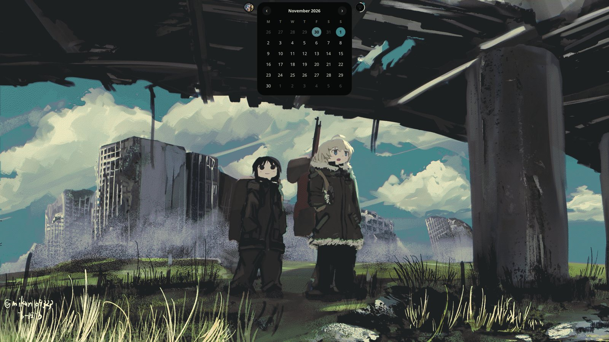
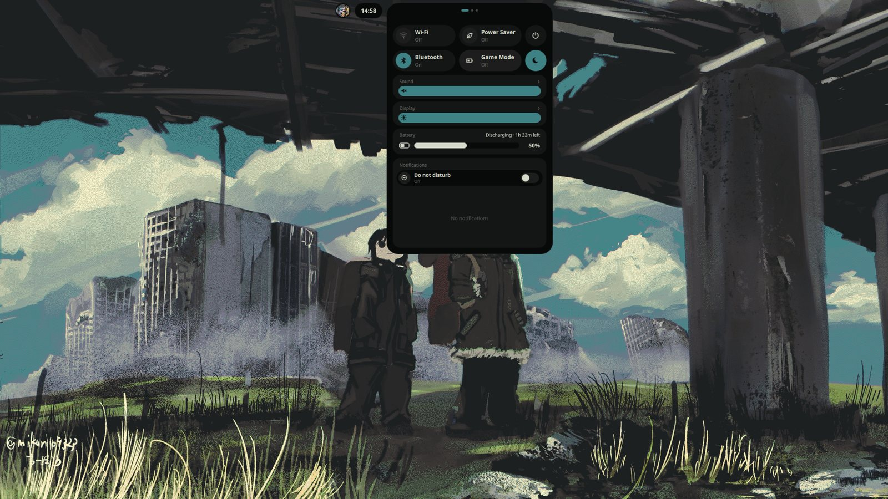
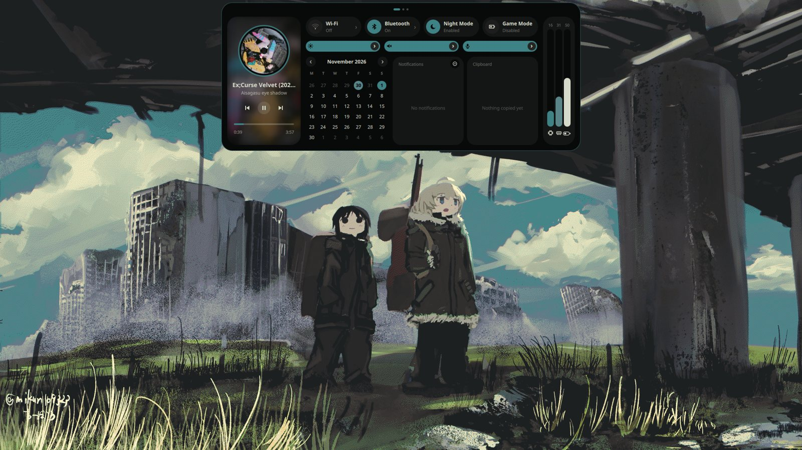
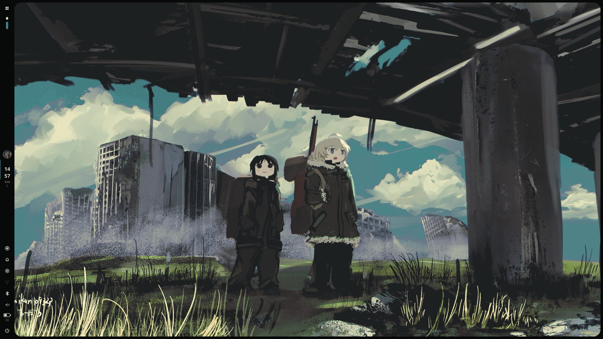
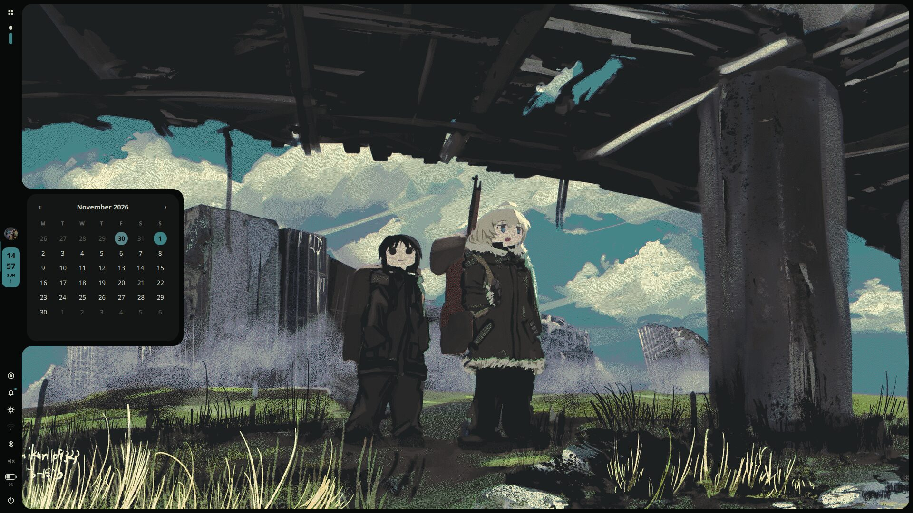
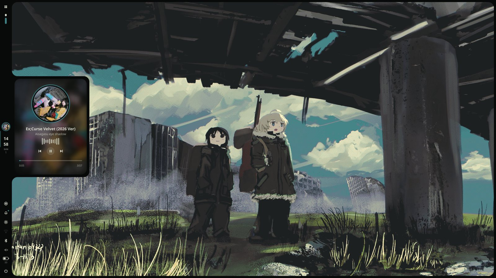
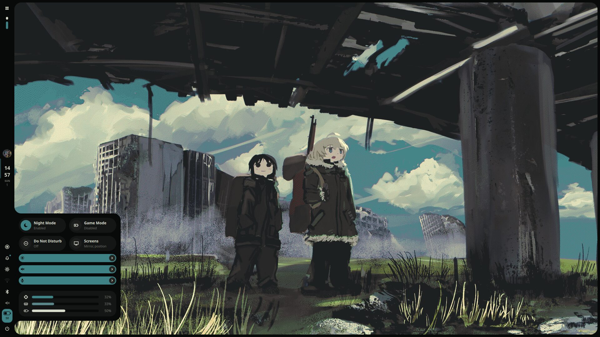
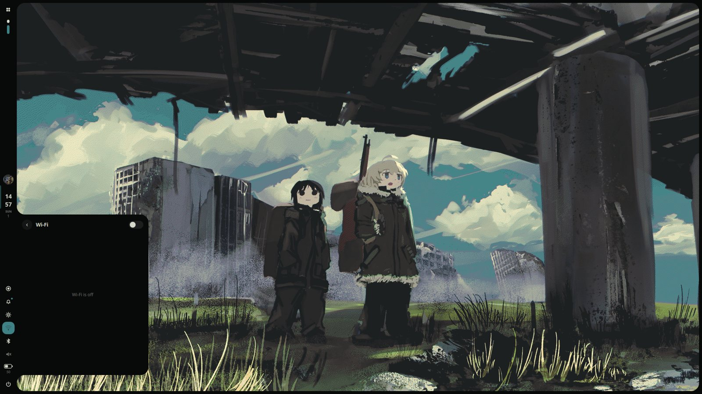
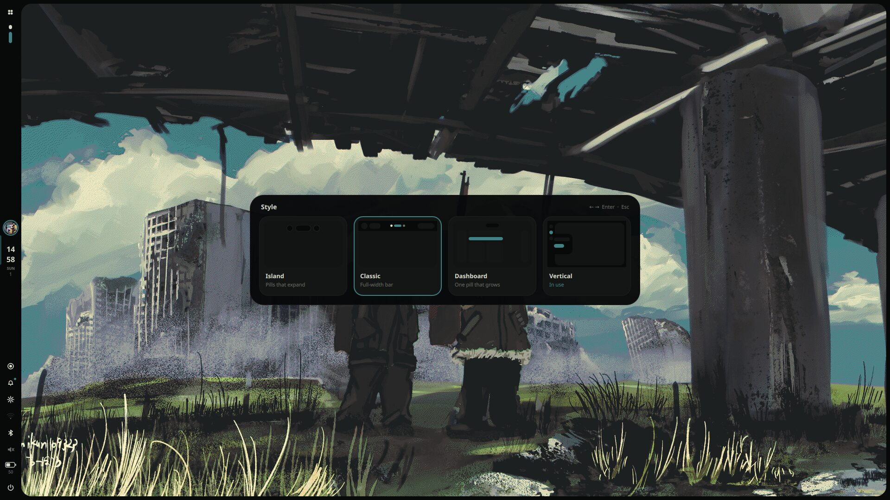
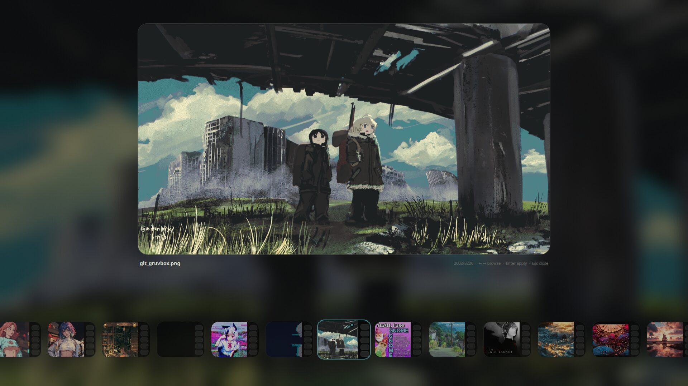

# quickshell-dots

🇬🇧 English · [🇮🇹 Italiano](README.it.md)

A complete desktop shell built with [Quickshell](https://quickshell.org), for **niri** and **Hyprland**.
One install, the same shortcuts and the same four styles on both compositors.

> ## ⚠️ Read this before opening an issue
>
> This is **not a project for everyone**. I made it because I felt like it, and it works on **my** laptop.
> It was not born to be a product: no roadmap, no support, no promises.
>
> 🤝 It was also **not made by me alone**: it is a 4-hands job with **Claude** (the *free* version, yes, really). I decide what I want, Claude writes the code, I break it, Claude fixes it. Repeat.
>
> - It breaks on your machine? Congratulations, you found a new feature. **Not my problem** 🫡
> - Pull requests and ideas are welcome, but I may answer in three weeks or never.
> - Everything is MIT: fork it, bend it, make it yours. That is the whole point.
> - It was tested on niri and Hyprland on Arch. Anything else: you are the tester now.

## Why this exists

I did not like most of the existing shells, and the rices I kept finding on GitHub were never quite *mine*. So I started building my own.

The inspiration comes from [SaneAspect](https://www.youtube.com/@saneAspect): I started from his videos. As far as I know, he builds his shells by hand, without AI, which is the opposite of what I did here. I did not buy his course (I am broke 💸), so I learned what I could from what is free, and filled the rest with Claude.

**Don't like that it was made with an AI?** That is completely fine. There are plenty of great shells written by humans: go and use those, and check out SaneAspect's channel first. I am just one of many, and this is just my own thing.

## Credits

**[SaneAspect](https://www.youtube.com/@saneAspect)**: a guy who makes excellent tutorials that help people learn Quickshell, and does it very well. Go and watch his channel.

## Screenshots

### Island

<p>



</p>

### Dashboard

<p>



</p>

### Vertical

<p>









</p>

### Style and wallpaper pickers

<p>




</p>

## What you get

- **4 styles you can switch live** (`Alt+S` opens the picker, or `Mod+Alt+1..4`): Island, Classic, Dashboard and Vertical. See [Styles](#styles).
- **Light / Dark mode** (`Mod+Alt+T`): regenerates the pywal palette with `wal -l`, so the shell, kitty and Firefox all go light or dark together.
- **10 themes per mode** (`Alt+T`): they don't touch pywal, they only change how the shell uses its colors (accent, background, borders, text). Cheap: no heavy effects.
- **A welcome tour** the first time the shell starts: choose the style, light or dark, theme and wallpaper, the clock, connect Wi-Fi and Bluetooth, set up the monitors, learn the shortcuts with a Try button, and see how the shell works inside. Reopen it from Settings, About, "Review the tour".
- **A real Settings panel** (`Alt+O`): a floating panel in the middle of the screen, always the same size, with a sidebar. Wi-Fi, Bluetooth, audio and monitors fill the whole page. Appearance (style, Dashboard version, light/dark, theme), bar and clock, notifications and OSD, wallpaper / lock / idle (auto-lock and screen off), monitors and display, network, Bluetooth, audio, power and battery, shortcuts, about.
- Launcher with favorites, power menu, lock screen, notification center with Do Not Disturb, calendar with reminders, timer and stopwatch.
- Quick settings: Wi-Fi, Bluetooth, sound, display, monitors (position, scale, rotation), keyboard layouts, Game Mode and Eco Mode.
- Wallpaper picker; the colors of the whole shell (and Firefox, with Pywalfox) follow the wallpaper through pywal.
- Screenshots and screen recording (with a name prompt and audio choice), media player with a live audio spectrum.
- Volume / brightness OSD that follows the style (Island: pill on the right; Classic: pill at the bottom; Dashboard: upright slider, or the bar itself in the Attached version; Vertical: fused with the right edge, volume and brightness one under the other), clipboard history.

## Install

```sh
git clone https://github.com/mohamedmousamm777-eng/quickshell-dots
cd quickshell-dots
sh install.sh
```

The installer is split in small files (`install.sh` + `installer/`) and tells you what it is doing at every step. First it asks **which kind of install** you want:

| | **Light** (recommended if you already have a config) | **Full** (what the author uses) |
|---|---|---|
| The shell (`~/.config/quickshell`) | installed | installed |
| Your `config.kdl` / `hyprland.lua` | **not replaced**: it only adds a marked block (4 `include` lines on niri, one block on Hyprland) | **replaced** by the author's config (a backup is saved first) |
| Gaps, rules, animations, window shortcuts | yours stay as they are | the author's |
| Shell shortcuts (`Alt+T`, `Print`...) | added **except the keys you already use** (they are skipped and listed at the end) | all of them |
| Starting the shell at login | added inside the block, if you do not already start it | in the config |
| Removing it later | `sh install.sh --uninstall` | restore the backup |

What it does, in order:

1. detects niri and/or Hyprland (or use `--niri`, `--hyprland`, `--all`);
2. checks the programs the shell needs and offers to install the missing ones (Arch: `pacman`, plus `yay`/`paru` for AUR packages);
3. saves a backup of everything it touches in `~/.config/quickshell-backup-DATE`;
4. finds other shells (noctalia, caelestia, DankMaterialShell, illogical-impulse...) and, if you agree, stops them and moves their settings to the backup (`--purge` also uninstalls their packages);
5. installs the shell (files of an older version that no longer exist are removed, they are in the backup) and then, depending on the type, the full config or the light block;
6. prepares the wallpapers folder, registers Pywalfox for Firefox and starts the shell.

Options: `--light`, `--full` (skip the question), `--yes` (ask nothing; Light unless `--full`), `--no-deps` (skip the programs check), `--purge`, `--uninstall`.

### Light mode in detail

- **niri**: it writes `~/.config/niri/quickshell-dots.kdl` (startup of the shell and a few layer rules, only what you do not already have) and `~/.config/niri/quickshell.kdl` (the shell shortcuts), and adds to your `config.kdl` four lines between the markers `quickshell-dots >>>` and `quickshell-dots <<<`.
- **Hyprland** (0.55+, Lua config): it writes `~/.config/hypr/quickshell-binds.lua` (only the shell shortcuts) and adds one block to your `hyprland.lua` between the same markers. If you still use `hyprland.conf`, Light mode skips Hyprland and tells you.
- **Key conflicts**: the installer reads the shortcuts of your config; if one of ours is already yours (`Alt+T`, `Print`...), yours wins: ours is commented out with a note, and the list of skipped keys is printed at the end. The same function stays available as a command (see [Commands](#commands)), so you can bind it to another key yourself.
- Running the installer again replaces only its own block: no duplicates.

### Updating

```sh
cd quickshell-dots
git pull
sh install.sh
```

It asks the install type again; use the same one as before. A backup is saved every time. In Light mode your config is never replaced; in Full mode it asks before replacing `config.kdl` / `hyprland.lua`, and if you answer `n` you keep your file (then new shortcuts only arrive if your file includes `quickshell.kdl` / `quickshell-binds.lua`).

### Uninstalling

`sh install.sh --uninstall` removes the marked block from your `config.kdl` / `hyprland.lua` and moves `~/.config/quickshell` to the backup. If you used Full mode, restore your old config from `~/.config/quickshell-backup-DATE`.

### Needs

`quickshell`, `awww` (or `swww`), `pywal`, `jq`, `grim`, `slurp`, `wf-recorder`, `ffmpeg`, `wireplumber`, `playerctl`, `brightnessctl`, `cava`, `cliphist`, `wl-mirror`, `imagemagick`, `libnotify`, `inotify-tools`, `xdg-user-dirs`, and optionally `python-pywalfox` (AUR) for Firefox. The installer registers it (`pywalfox install`); you then install the add-on once from [addons.mozilla.org](https://addons.mozilla.org/firefox/addon/pywalfox/). Pywalfox reads the colors pywal writes in `~/.cache/wal/`.

For Game Mode / Eco Mode, `power-profiles-daemon` (`powerprofilesctl`) is used for the power profile.

### Wallpapers

Put your images in `<Pictures>/Wallpapers` (for example `~/Pictures/Wallpapers` or `~/Immagini/Wallpapers`, the installer creates it), then press `Alt+W`.

## Styles

| Key | Style | What it is |
|---|---|---|
| `Mod+Alt+1` | **Island** | floating pills at the top that expand: music/launcher on the left, clock in the middle (calendar, notes), quick settings on the right |
| `Mod+Alt+2` | **Classic** | a full-width bar: launcher, workspaces, clock in the center, quick settings |
| `Mod+Alt+3` | **Dashboard** | one pill that grows: closed (workspaces, clock, status), mouse over (clock, date, music, status), click (a full dashboard with pages) |
| `Mod+Alt+4` | **Vertical** | a bar on the left with a thin frame around the screen; panels come out of the bar |

The Dashboard has two **versions**, chosen with `Alt+V`: *Pill* (floating) and *Attached* (a bar fused with the top edge of the screen, with a curve where it meets the edge; the menus come out of the edge with the same shape).

## Welcome tour

The first time the shell starts (about 11 seconds after login, once the quote has finished) a card opens in the middle of the screen with a short tour. It never appears again once you finish or skip it. You can use the arrow keys and `Enter` to move, and `Esc` to skip.

| Step | What you do |
|---|---|
| Welcome | A quick look at what ZenoShell is |
| Style | Pick Island, Classic, Dashboard or Vertical (and the Dashboard version). The shell changes behind the card |
| Colors | Light or dark, one of the 10 themes, and the wallpaper |
| Time and calendar | 24 h or 12 h with AM / PM, first day of the week, with a live preview |
| Wi-Fi and Bluetooth | The real pages, side by side, to connect right away |
| Monitors | Turn on or off, place, rotate, resolution and scale |
| Shortcuts | The keys in five groups. The **Try** button does the action for real; if it opens a menu, the tour steps aside until you close it |
| How it works | The path of a key press (key, `qs ipc call`, `ipc/ShellIpc`, `services/`, `widgets/`), where each folder lives, and how to make it yours |
| Ready | Open Settings or start using the shell |

To see it again: Settings (`Alt+O`), **About**, **Review the tour**. The "done" mark is `~/.local/state/quickshell/welcome.json`: delete that file and it opens by itself at the next start. It is different from Settings on purpose: Settings is where you change things later, the tour is only the first walk-through.

## Shortcuts

`Mod` = Super. The keys are identical on niri and Hyprland.

### The basic ones

| Keys | Action |
|---|---|
| `Mod+R` / `Alt+R` | launcher (type to search apps; `Enter` opens, `Esc` closes) |
| `Mod+M` / `Alt+P` | power menu (lock, logout, suspend, reboot, shutdown; the dangerous ones ask to be pressed twice) |
| `Alt+L` | lock the screen |
| `Mod+Return` `F` `E` | kitty, firefox, nautilus (edit them in your config) |
| `Mod+Q` / `Mod+V` | close window / toggle floating |
| `Mod+Ctrl+F` / `Mod+Shift+F` | fullscreen / maximize (keeps the bar and the gaps) |
| `Mod+C` `Mod+-` `Mod+W` | center, narrower, wider |
| `Mod+arrows` / `Mod+Shift+arrows` | focus / move |
| `Mod+1..0` / `Mod+Shift+1..0` | go to workspace / move the window there |
| `Mod+Shift+E` | quit the compositor |

Only on niri: `Mod+Tab` overview, `Mod+J` width presets, `Mod+,` `Mod+.` columns.
Only on Hyprland: `Mod+Tab` pin workspaces, `Mod+J` toggle split, `Mod+P` pseudo, `Mod+S` scratchpad.

### One by one

#### `Alt+O` — settings
Opens the Settings panel: a floating card in the middle of the screen, always the same size (it never turns into a window next to the others), with the sections on the left. `Alt+O` again, `Esc` or a click outside closes it. Open a section directly with `qs ipc call settings page <name>` (`appearance`, `bar`, `notifications`, `wallpaper`, `displays`, `network`, `bluetooth`, `audio`, `power`, `keys`, `about`). What you change there is saved in `~/.local/state/quickshell/`.

#### `Alt+W` — wallpaper picker
Opens a full-screen picker with the images of your `Wallpapers` folder. `←` `→` browse, `Home` / `End` jump to the first / last, `Enter` applies, `Esc` closes. Applying a wallpaper regenerates the pywal palette, so the shell, kitty and Firefox follow it. It respects the current Light / Dark mode.

#### `Alt+I` — system resources
A panel slides out of the **left edge** of the screen with three rings: CPU, RAM and DISK. It also opens by itself when the mouse touches that edge. `Alt+I` pins it open until you press it again.

#### `Alt+Tab` — show workspaces
Shows the workspaces for about 2.5 seconds (keep the mouse over it to keep it open). In Classic and Dashboard the workspaces are already in the bar, so no popup is shown there. `qs ipc call workspaces toggle` pins it until you repeat it.

#### `Alt+G` — Game Mode
For when you want every frame: it turns off animations, blur, shadows, rounded corners and gaps, and turns on Do Not Disturb. Press again and everything goes back as it was (including your previous Do Not Disturb setting). On niri it uses a small file included by `config.kdl`, on Hyprland a live setting; neither touches your config files.

#### `Alt+E` — Eco Mode
For when the battery matters: it sets the power profile to *power-saver* (needs `power-profiles-daemon`), lowers the brightness to 35% if it was higher, turns Bluetooth off, and turns off animations, blur and shadows. Press again: profile, brightness and Bluetooth come back as they were. Game Mode and Eco Mode exclude each other: turning one on turns the other off.

#### `Alt+D` — Do Not Disturb
Notifications stop popping up but they are kept in the notification center. The key turns it on without an end (and off again); when it is on, the quick settings show a row with `30 min`, `1 h`, `2 h`, `∞` to give it an end, and it turns itself off. Also: `qs ipc call dnd minutes 30`.

#### `Mod+Space` — next keyboard layout
Cycles through the layouts of your config (the default one has `it, us, gb, fr, de`) and shows a small notice with the layout in use. You can also choose it from the quick settings.

#### `Alt+S` — style picker
A picker with a drawn preview of the four styles. `←` `→` move, `1`-`4` pick, `Enter` confirms, `Esc` closes. The choice is saved.

#### `Mod+Alt+1` … `Mod+Alt+4` — styles directly
Island, Classic, Dashboard, Vertical, without opening the picker.

#### `Alt+T` — theme picker
Opens, **from the pill** (or from the side panel in Vertical), a carousel with the 10 themes of the current mode. `←` `→` move: the carousel moves first and the shell repaints with the theme right after; `Enter` applies, `Esc` goes back to the previous theme, `Tab` switches Light / Dark. The themes only change how the shell uses the pywal colors, so they are cheap: Classic, Vivid, Complement, Triad, Analog, Mono, Tinted, Sober, Contrast, Neon.

#### `Mod+Alt+T` — Light / Dark
Switches between the light and the dark palette: it regenerates the pywal colors from the current wallpaper (`wal -l` for light), so the shell, **kitty and Firefox** change together. Does not change the wallpaper.

#### `Alt+V` — Dashboard version
Only for the Dashboard style (`Mod+Alt+3`). Opens a small picker, from the pill, with the two versions: *Pill* and *Attached*. `←` `→` browse (shown live), `Enter` applies, `Esc` cancels. In the *Attached* version the bar is fused with the top edge and, when music is playing, the bar that appears with the mouse over also shows the song (cover, title, artist and a progress bar).

#### `Print` — screenshot and recording menu
Opens a menu to choose what to capture (screen, area, window; or to record) and the audio of the recording (none, microphone, system, both). If a recording is running, `Print` stops it.

#### `Mod+H` / `Mod+Shift+H` / `Mod+Ctrl+H` — screenshot
Screen / area / window, straight away. The image goes to `~/Screenshots` and to the clipboard, and a notification tells you.

#### `Mod+Alt+H` / `Mod+Alt+Shift+H` — record the screen / an area
Starts recording the screen / a selected area; press the same keys again to stop. Files go to `~/Videos/Recordings`; when you stop, a small prompt lets you name the file (empty = keep the date and time name).

#### `Mod+Alt+P` — pause the recording
Pauses and resumes the recording in progress (the parts are merged when it ends, so `ffmpeg` is needed).

## Commands

Everything is also a command: `qs ipc call <target> <function>`. This is also what you use to bind a function to another key if one of ours was skipped.

| Target | Functions |
|---|---|
| `launcher` | `toggle` `open` `close` |
| `power` | `toggle` `open` `close` |
| `lock` | `lock` |
| `wallpaper` | `toggle` |
| `settings` | `toggle` `open` `close` `page <name>` |
| `system` | `toggle` `show` `hide` |
| `workspaces` | `peek` `show` `toggle` |
| `gamemode` | `toggle` `on` `off` |
| `powersaver` (Eco Mode) | `toggle` `on` `off` |
| `dnd` | `toggle` `on` `off` `minutes <n>` |
| `layout` | `next` `previous` |
| `style` | `toggle` `open` `close` `set <island\|classic\|dash\|side>` `variant` `setvariant <pill\|attached>` |
| `theme` | `toggle` `open` `close` `set <name>` `mode <dark\|light\|toggle>` |
| `capture` | `toggle` `open` `stop` `pause` `recscreen` `recarea` `shotscreen` `shotarea` `shotwindow` `audio <off\|mic\|system\|both>` |

For example: `qs ipc call theme set neon`, `qs ipc call style setvariant attached`.

## Layout of the repository

```
install.sh        the installer (entry point)
installer/        one small file per step (deps, shells, shell, full, light-niri, light-hypr, finish, uninstall)
quickshell/       the shell  ->  ~/.config/quickshell
niri/             config.kdl (Full), quickshell.kdl (shortcuts), light-base.kdl, + files the shell manages
hypr/             hyprland.lua (Full), quickshell-binds.lua (shortcuts), + file the shell manages
```

`quickshell-outputs.*` and `quickshell-tweaks.kdl` are written by the shell itself (Monitors page, Game/Eco Mode): don't delete them.

## Restore

Everything the installer replaced or removed is in `~/.config/quickshell-backup-DATE`.

## License

MIT
