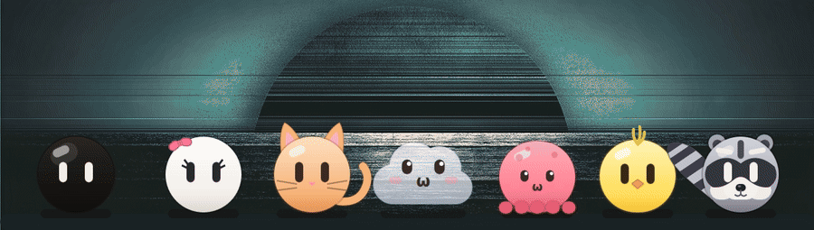
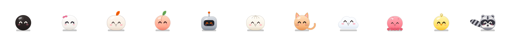

# Aibou

Small companions that live on a [niri](https://github.com/YaLTeR/niri) desktop with
[DankMaterialShell](https://github.com/AvengeMedia/DankMaterialShell). They walk along the bottom
edge behind your windows, melt into the screen frame while you work, climb the walls, swing along
the top edge, play with each other, dance to your music and come to the front when something
happens on the machine. You can drag them, throw them, tickle them and chat with them.

*Aibou* (相棒) is Japanese for partner or buddy.



## Figures

Up to five at a time, each with its own look, habits and voice.



| Figure | Looks | Likes |
|---|---|---|
| Kuro | dark glass ball with long eyes, tinted like your frame | the grappling gun, polishing his glass |
| Shiro | light ball with lashes and a bow | climbing, juggling, company |
| Mochi | rice cake with a leaf | naps up in the top frame, dango |
| Momo | peach | yoga |
| Robo | little robot with an antenna | repairs, oil |
| Bao | steamed bun | food, more food |
| Neko | ginger cat | chasing the pointer, grooming, fish |
| Kumo | see-through cloud | floating instead of walking, naps in the sky; rains when sad |
| Tako | octopus | the best climber, juggles, squirts ink when startled |
| Hiyoko | chick | tiny quick hops, pecking seeds, lots of cheeping |
| Arai | raccoon | tidying up (picks up banana peels instead of slipping on them) |

Traits and lines per figure live in [`shell/Persona.js`](shell/Persona.js).

## What they do

- Walk, roll, hop over each other, meet, tease and quarrel, kiss and hug, high five.
- Melt into the bottom frame or the side of the bar while you work and peek out now and then.
  With an open DMS popout they move out of its way.
- Climb up a wall hand over hand, along the top edge, swing like on monkey bars, use a grappling
  gun, drop or abseil down.
- Play tag, hide and seek, races, rock paper scissors, leapfrog, skipping rope and catch with a ball.
- Dance to whatever plays (playerctl and cava), in pairs too.
- React to the machine: high load makes them sweat, a crashed program or failed unit makes them
  cross; they tell you about finished downloads, builds and updates, low battery, a USB stick,
  a microphone or screen recording that is on.
- Jump for the pointer when it comes close, hang on to it, fall off when you shake it.
- Lift the bottom of a window like a cloth when they come to the front.
- Chat in a small window that grows out of the figure (Claude by default, other providers
  possible). The chat doubles as a command line for the figures and as a small shell (`!command`).

Everything follows the DMS colours, frame and language. The figures speak English, German and
Japanese (calls, chat window and chat); the settings page also comes in Spanish, French, Italian,
Portuguese, Russian and Chinese.

## Requirements

- niri and DankMaterialShell 1.6.1 or newer, with the connected frame
- Quickshell 0.3 (the one DMS runs on), Qt 6
- Python 3
- For some features: `playerctl` and `cava` (dancing), `grim` (finding a free spot in the bar),
  `inotifywait` from inotify-tools (downloads), `busctl` (notifications), `gdbus` (lock screen),
  `pactl` (microphone), `secret-tool` (API keys of other chat providers), `checkupdates` from
  pacman-contrib (updates on Arch)
- For the chat: the [Claude Code](https://docs.claude.com/en/docs/claude-code) CLI (`claude`), or
  an OpenAI-compatible or Anthropic API key set up on the settings page (kept with `secret-tool`).
  Without Claude Code, pick your provider as "Chat model" on the settings page or with the bolt
  button in the chat window; the choice is kept.

## Install

### From the DMS plugin registry

`dms plugins install aibou` (or Settings → Plugins → Browse) clones the whole repository to
`~/.config/DankMaterialShell/plugins/.repos/` and links only the tile. The figures themselves
still need the helper and the service, linked from that clone:

```sh
repo=$(dirname "$(readlink -f ~/.config/DankMaterialShell/plugins/aibou)")
ln -s "$repo/bin/aibou" ~/.local/bin/aibou
systemctl --user link "$repo/systemd/aibou.service"
systemctl --user enable --now aibou.service
```

Then add the layer rules below. `dms plugins update` updates the figures along with the tile.
Run `aibou off` before `dms plugins uninstall aibou`: uninstalling deletes the clone, and the
service would keep trying to start from it.

### By hand

Clone it anywhere, link the helper, the DMS plugin and the service:

```sh
git clone https://github.com/satoshoe-dev/aibou ~/.local/share/aibou
ln -s ~/.local/share/aibou/bin/aibou ~/.local/bin/aibou
ln -s ~/.local/share/aibou/dms-plugin ~/.config/DankMaterialShell/plugins/Aibou
systemctl --user link ~/.local/share/aibou/systemd/aibou.service
systemctl --user enable --now aibou.service
```

Add these layer rules to your niri config, so the figures stay behind the windows and do not move
with the workspaces:

```kdl
layer-rule {
    match namespace="^aibou$"
    place-within-backdrop true
}
layer-rule {
    match namespace="^aibou-wall$"
    place-within-backdrop true
}
layer-rule {
    match namespace="^aibou-stage$"
    shadow { off; }
}
layer-rule {
    match namespace="^aibou-dock$"
    shadow { off; }
}
```

Restart DMS once so it finds the plugin, enable it under Settings → Plugins and add the Aibou tile
to the Control Center. The settings page has the figures, colours, activity, the chat model and
the measured costs.

Shortcuts are up to you; for example:

```sh
dms keybinds set niri Mod+Alt+M 'spawn "aibou" "front"' --desc 'Aibou: to the front and back'
dms keybinds set niri Mod+Alt+C 'spawn "aibou" "chat"' --desc 'Aibou: chat'
dms keybinds set niri Mod+Alt+Z 'spawn "aibou" "sleepToggle"' --desc 'Aibou: sleep or wake'
dms keybinds set niri Mod+Alt+B 'spawn "aibou" "play"' --desc 'Aibou: ball'
dms keybinds set niri Mod+Alt+Shift+M 'spawn "aibou" "toggle"' --desc 'Aibou: on or off'
```

## Use

```sh
aibou on | off | toggle | state     # the service
aibou status                        # what each figure is doing (JSON)
aibou front | chat | play | sleepToggle | visit | say "hello"
```

Every other word is passed to the scene over Quickshell IPC (`qs -p shell ipc call aibou …`).
In the chat window you can type commands without a prefix: `jump`, `dance`, `kiss kuro shiro`,
`climb arai`, `happy 3`, `more`, `fewer`, `help`. Anything that is not a command goes to the AI.
Left click a figure to tickle it, double click for the chat, drag to pick it up and throw it.

What you change from the chat (`more`, `fewer`, the activity) is kept in
`~/.local/state/aibou/chosen.json`; the settings page takes it over into DMS when you open it.

## What Aibou watches

Everything below stays on the computer, apart from the chat.

- Always: niri's event stream (windows, focus, workspaces, screen casts), the pointer position,
  DMS's settings, colours and wallpaper, CPU load, memory and temperature from `/proc` and `/sys`,
  the battery, MPRIS players, and the lock state from logind.
- While music plays and "Dances to music" is on: a small `cava` for the beat.
- "Feels the machine" (on by default): the system journal for crashed programs and failed
  services, and DMS's own log for error lines.
- "Notifications" (off by default): the title and text of every notification on the session bus.
- "Notices what happens" (off by default): `~/Downloads`, USB drives, which programs use the
  microphone, the names of the running programs every 15 s (long builds, screen recorders), and
  `checkupdates` every three hours.
- "In the bar: face only": a screenshot of a strip of the bar (`grim`), to find a free spot
  between the icons.

## Chat and desktop help

The chat sends your messages off the machine: to Anthropic through the `claude` CLI, or to the
provider you set up on the settings page. A line that starts with `!` runs as a command in bash,
the way it would in a terminal.

"Desktop help" is off by default. Switched on, the chat may read the desktop's config folders
(niri, DankMaterialShell, quickshell, aibou, matugen, GTK, Qt, Kvantum, kitty, fontconfig under
`~/.config`), this repository, DMS's cache and the folders under "readDirs", and run a list of
read-only commands, each exactly as listed (a few take arguments, such as a unit for journalctl).
Files named like tokens, passwords or keys are refused everywhere; still, do not add folders that
hold secrets. What it reads goes to the chat provider along with your message. The model gets no
shell and none of Claude Code's own tools: it reads through three tools that the daemon serves
(`aiboud --mcp`), the same ones the other providers get. Changes come as cards with a button and
nothing runs until you click it. A block list stops root rights and
restarts of DMS or niri regardless of what the model says. If you keep a Claude Code skill about
your desktop in `~/.claude/skills/desktop` (or set `AIBOU_SKILL_DIR`), it is read into the help.

Your own read-only commands and block rules go into `~/.config/aibou/desktop-help.json`. A
command ending in ` *` may take arguments, the others run only exactly as written:

```json
{
  "readCommands": ["mytool status", "mytool show *"],
  "blocked": [["\\bmytool\\s+reset\\b", "resets only by hand"]]
}
```

## Optional extras

None of these are needed; without them the figures do a little less. The niri and DMS patches
mentioned here are not part of this repository and not supported: Aibou runs on stock niri and
stock DMS. It asks DMS once at the start (and after a DMS restart) whether it can draw the domes;
a stock DMS says no and is not asked again.

- `tools/kuro_wallpaper.py` renders a Kuro wallpaper (dark and light). Put the PNGs into
  `~/Pictures/Wallpapers`; Aibou swaps them with the light and dark mode and draws Kuro's eyes alive
  on top, blinking and following the pointer.
- A niri build that reports the pointer position and the positions of tiled windows over IPC lets
  the figures jump for the pointer and lift tiled windows. Plain niri gives neither, the rest works.
- DMS can draw the domes in the frame as part of its own frame body (same glass, round joins),
  given a small patch to its connected frame. Without it Aibou draws the domes itself.

## Costs

At rest under 1 % CPU, about 130 MB of memory for the scene and 13 MB for the daemon. Costs come
almost only from movement, because every frame drawn costs CPU in Qt and the graphics driver; they
grow with the refresh rate. The service runs with Qt's basic render loop, which roughly halves the
cost while figures move. Measured on an Intel Iris Xe at 2560×1600 and 165 Hz, share of one core:

| State | CPU |
|---|---|
| three asleep, sleep animation off | 0.2 % |
| three asleep, breathing | 1.75 % |
| one resting in the frame | 1.9 % |
| one awake, walking about | 3.3 % |
| three awake | 8.5 % |
| five playing ball | 29 % |

On battery (setting "Battery saver") they play less, set off less often and sleep sooner.

## Layout

| Part | Where |
|---|---|
| Scene (Quickshell) | `shell/` (`shell.qml`, `Character.qml` state, `Creature.qml` drawing, `Brain.qml` behaviour) |
| Daemon | `daemon/aiboud`: niri events, pointer, DMS colours and frame, battery, music, chat, the watchers above |
| DMS plugin | `dms-plugin/`: Control Center tile and settings page |
| Helper and service | `bin/aibou`, `systemd/aibou.service` |
| Tile pictures | `shell/thumbs/`, made by `qs -p shell/thumbs.qml` and `tools/thumbs_crop.py` |
| README animation | `shell/demo.qml`, `tools/demo_gif.sh WALLPAPER` |

## License

MIT
