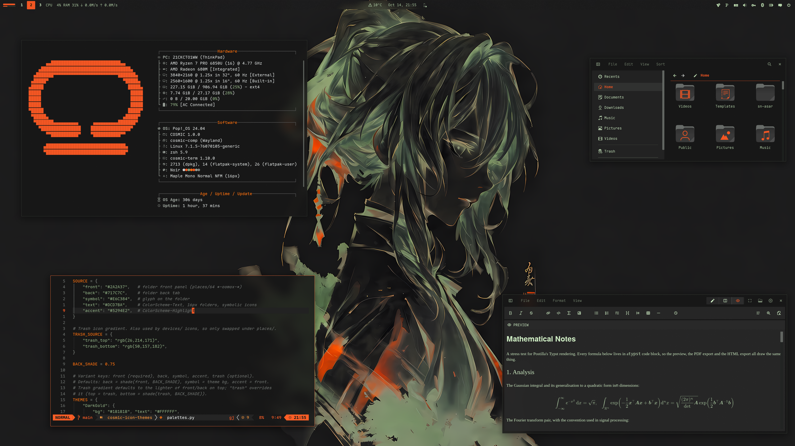

<div align="center">

# COSMIC · Noir

Pop!_OS 24.04 on COSMIC in charcoal, sage and orange: desktop, terminal,
shell, Firefox, cursor, wallpapers. The dark half of a pair; the light half is
[cosmic-dossier-theme](https://github.com/atraxsrc/cosmic-dossier-theme).


</div>

---


## Palette

From the Omarchy [Greek Noir](https://github.com/HANCORE-linux/omarchy-greek-noir-theme)
theme: a near-black base, grey-sage neutrals, one loud orange. The accent is
kept as is. Every text colour is at least 4.5:1 on the window background.

| Role | Color | Hex |
|------|-------|-----|
| Background |  Charcoal | `#171717` |
| Containers |  Soot / Slate | `#222222` / `#2A2A2A` |
| Text |  Fog | `#CCD0CF` |
| Accent |  Orange | `#F25623` |
| Warning |  Ember | `#F56E0F` |
| Success |  Sage | `#88A57D` |
| Khaki |  Symlinks, yellow slot | `#AEAB94` |
| Grey-sage |  Directories | `#959C95` |
| Muted |  Secondary text | `#7D837D` |
| Dim |  Comments | `#686C69` |
| Lines |  Box lines, inactive | `#525252` |

Error shares the orange: the upstream palette has no red, and its "red" slot
is khaki. Errors are told apart by bold and underline.

| Role | Noir | Dossier |
|------|------|---------|
| Background | `#171717` | `#D0D0C8` |
| Text | `#CCD0CF` | `#242424` |
| Accent | `#F25623` | `#953B19` |
| Success | `#88A57D` | `#51573B` |

---

## Repo Structure

```
.
├── btop
│   └── Noir.theme               # btop colour theme
├── claude-desktop
│   ├── cosmic-noir.jsonc        # Claude Desktop theme (claude-desktop-extra), dark + light
│   └── install.sh
├── cosmic
│   ├── Noir.ron                 # COSMIC Appearance import (Dark)
│   ├── config/                  # baseline settings: fonts, icons, terminal look
│   └── install.sh
├── cosmic-term
│   ├── Noir-term.ron            # COSMIC Terminal colour scheme
│   ├── Noir-term-*.ron          # dimmer plain-text variants, same ANSI colours
│   └── README.md                # previews and which one to pick
├── cursors
│   ├── Oxygen-Noir-*/            # cursor themes, one per icon colour, patched for COSMIC apps
│   ├── install.sh
│   ├── uninstall.sh
│   └── README.md
├── icons
│   └── install.sh               # Cosmic-Noir icon pack from cosmic-icon-themes
├── fastfetch
│   ├── config.jsonc             # orange / grey-sage fastfetch config
│   ├── cosmic.txt               # COSMIC logo
│   └── install.sh
├── firefox
│   ├── theme                    # Cosmic Noir theme add-on (manifest + icons)
│   ├── chrome
│   │   ├── userChrome.css       # rounded chrome, soot menus
│   │   └── userContent.css      # new tab accent
│   ├── install.sh
│   └── README.md
├── lsd
│   ├── config.yaml              # theme: custom
│   ├── colors.yaml              # permission / size / date / git columns
│   └── install.sh
├── nvim                         # Neovim colorscheme, LazyVim spec, RON syntax, install.sh
├── telegram
│   ├── colors.tdesktop-theme    # Telegram Desktop colour scheme (source)
│   ├── cosmic-noir.tdesktop-theme  # built theme, open this in Telegram
│   └── build.sh                 # rebuilds it, optionally with a wallpaper
├── vscode
│   ├── themes/                  # Cursor / VS Code colour themes, Noir (dark) + Dossier (light)
│   ├── package.json             # extension manifest
│   ├── install.sh               # packs a .vsix, installs it with cursor --install-extension
│   └── README.md
├── scripts
│   ├── update_system.sh         # nala + flatpak, orange / sage ANSI
│   └── switch.sh                # make this the active rice (see Switching rice)
├── zsh
│   ├── noir.zsh                 # LS_COLORS, highlighting colours, aliases, starship
│   └── install.sh
├── assets
│   ├── cursors/                 # cursor preview
│   ├── cosmic-term/             # scheme previews for cosmic-term/README.md
│   ├── screenshot.png           # README screenshot
│   └── wallpaper.png            # the anime portrait on the bare desktop
├── backgrounds/                 # wallpapers, noir-<subject>.png (see Icons and wallpaper)
├── docs
│   └── showcase.md              # the rice describing itself, for the Postilla pane of the screenshot
├── LICENSE
└── README.md
```

---

## COSMIC Desktop

Settings → Desktop → Appearance → **Dark** → **Import** → `cosmic/Noir.ron`

Accent is orange `#F25623`. Use the `+` control if you want a custom swatch.

Frosted glass is on in the `.ron` at `frosted: Low` with an opacity table of
0.66 to 0.96, tinted with the palette's middle neutral, for windows, panel,
applets and system UI (maximized apps stay solid), and corners are squared
(`radius_*: 2.0`), the same as the DarkGold baseline. Adjust frosted glass on
Appearance → Style → Frosted glass after import; those sliders survive a theme switch.

Export from Appearance if you tweak backgrounds / tints so you do not lose them.

Pairing tip: import `Dossier.ron` from
[cosmic-dossier-theme](https://github.com/atraxsrc/cosmic-dossier-theme) into
the Light slot and COSMIC's Dark / Light toggle flips between the two.
Wallpaper, Firefox and the shell layer do not follow the toggle; those are
per-rice files.

### Baseline settings

`cosmic/config/` holds the settings that make up the look and rarely change
(panel, dock, applets and shortcuts are left out on purpose):

| Where | Setting |
|-------|---------|
| Fonts | Interface `Maple Normal UI` Light, monospace `Maple Mono Normal NFM` |
| Icons | Cosmic-Noir-Orange |
| Windows | Minimize / maximize buttons hidden, theme applied to GNOME apps |
| Terminal | Maple Mono 15 (weights 500 / bold 800 / dim 300), 77% opacity, no header bar, Noir |

Install the [Maple fonts](https://github.com/subframe7536/maple-font) and the
Cosmic-Noir icons (see Icons below) and import the terminal scheme first, then:

```bash
./cosmic/install.sh
```

It backs up each file it replaces to `*.bak` and COSMIC applies it live.

The interface font is the Light weight on purpose. COSMIC sets interface text
brightness itself (the text tint only picks the hue), so on these dark panels
labels land near `#DFE7DF` whatever tint you choose; the thinner strokes are
what calms them at night. Settings → Fonts lists only families, so the weight
lives in `cosmic/config/com.system76.CosmicTk/v1/interface_font`.

---

## COSMIC Terminal

The desktop `.ron` does not colour ANSI text.

1. COSMIC Terminal → **View → Color schemes…** (not Settings → Appearance)
2. Dark tab → **Import** → `cosmic-term/Noir-term.ron`
3. View → Settings → Appearance → Color scheme (dark) → **Noir**

If a profile is set as default, set the scheme on that profile too or the
dropdown will look like it did nothing.

Fog text on charcoal; orange for errors and the cursor, sage for strings and
success, khaki in the yellow slot, grey-sage for directories.

If fog glares at night, there are five dimmer variants with the same ANSI
colours, from Smoke `#7D837D` up to Pale `#BCBFBC`. Previews and which to
pick: [`cosmic-term/README.md`](cosmic-term/README.md).

---

## Firefox

Two layers:

1. **Theme (colours):** install
   **[cosmic-noir-theme on addons.mozilla.org](https://addons.mozilla.org/en-US/firefox/addon/cosmic-noir-theme/)**.
   This is the main look.
2. **Stylesheets (optional):** `firefox/chrome/` adds rounded corners, orange
   menu hover, orange accents and blank new-tab tiles on top of the add-on
   (they also work with Firefox's built-in Dark theme):

```bash
./firefox/install.sh
```

Fully quit Firefox afterward. Details and CSS rules: [`firefox/README.md`](firefox/README.md).

---

## Claude Desktop

For the unofficial [claude-desktop-extra](https://github.com/patrickjaja/claude-desktop-extra)
Linux build. `claude-desktop/cosmic-noir.jsonc` is one theme with both halves:
Noir in dark mode and Dossier in light mode, so Claude's own
Settings → Appearance toggle switches between the two rices.
Colours come from `cosmic/*.ron`, contrast-checked (text and button text
4.5:1, accents 3:1).

```bash
./claude-desktop/install.sh
```

It copies the file into `~/.config/Claude/themes.d/`. Then press
<kbd>Ctrl</kbd>+<kbd>Shift</kbd>+<kbd>T</kbd> in Claude Desktop and pick **cosmic-noir**.

The same file ships in [`cosmic-dossier-theme`](https://github.com/atraxsrc/cosmic-dossier-theme),
so installing from either repo gives the same theme.

---

## Cursor editor

`vscode/` is a colour theme extension for [Cursor](https://cursor.com) with
both halves of the pair: **Cosmic Noir** and **Cosmic Dossier**. It is a plain
VS Code theme extension, so VS Code and VSCodium take it too, and the same
folder ships in cosmic-dossier-theme. Code is coloured the way Neovim is in
each rice; the workbench is charcoal with soot menus, hovers and inputs,
orange on the active tab, buttons and menu highlight, and the integrated
terminal uses the COSMIC Terminal scheme. Cursor builds its Agent and chat
panels from the same theme colours, so they follow along.

```bash
./vscode/install.sh
```

It packs `vscode/` into a `.vsix` and installs it with
`cursor --install-extension`; run it again after editing the theme. Then press
<kbd>Ctrl</kbd>+<kbd>K</kbd> <kbd>Ctrl</kbd>+<kbd>T</kbd> in Cursor and pick
**Cosmic Noir**. Three lines in Cursor's `settings.json` make it follow
COSMIC's Dark / Light toggle between Noir and Dossier; they, the colours and
the contrast notes are in [`vscode/README.md`](vscode/README.md).

---

## Telegram

`telegram/cosmic-noir.tdesktop-theme` is a Telegram Desktop theme: charcoal
chat list and background, soot incoming and dark-sage outgoing bubbles, orange
for the accent, links, unread badges and buttons (with charcoal text on them),
sage for online status and read ticks. Group member names cycle through eight
of the rice's colours: orange, sage, khaki, grey-sage, pale khaki, amber, light
sage and ember. Text and badge colours are contrast-checked at 4.5:1 or better,
except disabled menu items.

Settings → Chat Settings → Chat wallpaper → **Choose from file** →
`telegram/cosmic-noir.tdesktop-theme` → **Apply this theme**.

The colours live in `telegram/colors.tdesktop-theme`, which is plain text;
`build.sh` zips it with the chat background into the `.tdesktop-theme`. The
background is plain charcoal; to put a wallpaper behind the chat instead
(ImageMagick re-encodes it to a 2560px JPEG, Telegram caps theme files at 5 MB):

```bash
./telegram/build.sh --wallpaper backgrounds/noir-anime.png
```

Built against Telegram Desktop 7.3.1. Calls, group calls, statistics charts and
premium badges keep Telegram's own colours.

Telegram has no dark / light pairing, so Dossier, the light half, ships its own
theme.

---

## Cursor

**Oxygen** cursors recoloured to the icon colours, one per folder colour of the
Cosmic-Noir icon pack: **Orange** (default), **Sage**, **Dark**. Patched with the cursor
names COSMIC apps ask for. COSMIC has no cursor picker yet, so the script sets it:

```bash
./cursors/install.sh                      # Orange
./cursors/install.sh --variant Sage      # or another, see --list
reboot
```

Previews, what the script touches, how to undo it and how the colours are made:
[`cursors/README.md`](cursors/README.md).

---

## Scripts

### `update_system.sh`

nala + flatpak updater. Headers in orange, info in grey-sage, success in sage,
errors in orange; the banner ramps from sage to fog, orange only in the rule below it.

```bash
chmod +x scripts/update_system.sh
./scripts/update_system.sh
```

### `switch.sh`

Makes this the active rice, coming from any other `cosmic-*-theme` rice. See
[Switching rice](#switching-rice).

```bash
./scripts/switch.sh
```

---

## Terminal extras

Need a [Nerd Font](https://www.nerdfonts.com/) in the terminal for the icons
(Maple Mono NFM in the baseline above).

### zsh

`zsh/noir.zsh` is the rice part of the shell only: `LS_COLORS` (also used by
lsd for file names and by the completion menu), orange / sage / khaki colours
for zsh-autosuggestions and zsh-syntax-highlighting, lsd / bat / nvim aliases
and the starship prompt. Your own `~/.zshrc` stays private and sources it.

Needs zsh + [oh-my-zsh](https://ohmyz.sh/). `install.sh` clones the two
plugins if missing and appends one `source` line to `~/.zshrc` (backup in
`~/.zshrc.bak`):

```bash
./zsh/install.sh
exec zsh
```

In `~/.zshrc` keep `ZSH_THEME=""` and
`plugins=(git sudo zsh-autosuggestions zsh-syntax-highlighting)`.

### lsd

File names are coloured by `LS_COLORS` from `zsh/noir.zsh`;
`lsd/colors.yaml` colours the other columns with the 256-colour codes nearest
the palette (202 orange, 208 ember, 108 sage, 144 khaki, 246 grey-sage,
243 muted, 240 dim). lsd 1.0.0 does not accept `#hex` there.

```bash
./lsd/install.sh
lsd -l
```

### fastfetch

COSMIC logo in orange, Hardware / Software / Age boxes in dim grey with
grey-sage keys. `install.sh` backs up any existing
`~/.config/fastfetch/config.jsonc` to `config.jsonc.bak`.

```bash
./fastfetch/install.sh
fastfetch
```

### Neovim

`nvim/` carries the rice into Neovim: a dependency-free colorscheme built from
the palette (`nvim/colors/noir.lua`), a LazyVim spec that selects it and makes
sure the treesitter parsers for the files in this repo are installed
(`nvim/lua/plugins/noir.lua`), and a small RON syntax file so `cosmic/*.ron`
is coloured even before the parser exists. `:terminal` inside Neovim uses the
Noir scheme.

```bash
./nvim/install.sh
# restart nvim; LazyVim switches to the noir colorscheme
```

Without LazyVim, copy `nvim/colors/noir.lua` to `~/.config/nvim/colors/` and
run `:colorscheme noir`.

### btop

`btop/Noir.theme`: charcoal background, dim grey boxes, orange titles, meters
ramp from sage through khaki to orange.

```bash
mkdir -p ~/.config/btop/themes
cp btop/Noir.theme ~/.config/btop/themes/
# btop → Esc → Options → Color theme → Noir
```

---

## Icons and wallpaper

Icons: **Cosmic-Noir**, the [Kanagawa icons](https://github.com/Fausto-Korpsvart/Kanagawa-GKT-Theme/tree/main/icons/Kanagawa)
by Fausto Korpsvart recolored to this palette in
[cosmic-icon-themes](https://github.com/atraxsrc/cosmic-icon-themes). Folders come in
three colors: **Orange** `#F25623` (default), **Sage** `#88A57D` and **Dark** `#2A2A2A` with orange symbols.


```bash
./icons/install.sh                 # Orange folders
./icons/install.sh --variant Sage  # or Dark
```

It downloads the pack from the latest cosmic-icon-themes release, checks its SHA256,
installs it to `~/.local/share/icons/` and sets it as the COSMIC icon theme.
Restart open apps afterwards (Files caches icons per window).
Add `--system` to install to `/usr/share/icons` instead, for every user and the
login screen (asks for sudo); `--user` is the default.

Wallpapers ship in [`backgrounds/`](backgrounds/), named `noir-<subject>.png`:
the thirteen subjects every dark rice has, rendered in sage and orange on charcoal:
the Harbor Dark reaper and Hyundai blueprint, the COSMIC astronaut, the samurai,
sushi switch, geisha, JS mug and neon street from the Tokyo Night set, The Greek
eagle and ink portrait, and three new scenes: city, panel and tower.
The anime portrait (`noir-anime.png`) is the one in the screenshot.
The subjects come from [HANCORE-linux](https://github.com/HANCORE-linux) (MIT) and
[cool-wallpapers](https://github.com/atraxsrc/cool-wallpapers); each was rendered again in this palette, then upscaled.
More from the upstream theme in cool-wallpapers, folder
[`omarchy/greek-noir/`](https://github.com/atraxsrc/cool-wallpapers/tree/main/omarchy/greek-noir) (MIT).

Settings → Wallpaper → Add image → a file from `backgrounds/`, or one you downloaded.


---

## Setup

```bash
git clone https://github.com/atraxsrc/cosmic-noir-theme.git
cd cosmic-noir-theme

# desktop
# Settings → Appearance → Dark → Import cosmic/Noir.ron

# terminal
# View → Color schemes → Import cosmic-term/Noir-term.ron

# firefox add-on
# https://addons.mozilla.org/en-US/firefox/addon/cosmic-noir-theme/

# optional extra chrome
./firefox/install.sh

# claude desktop (claude-desktop-extra), then Ctrl+Shift+T
./claude-desktop/install.sh

# cursor editor, then Ctrl+K Ctrl+T → Cosmic Noir
./vscode/install.sh

# telegram desktop
# Settings → Chat Settings → Chat wallpaper → Choose from file → telegram/cosmic-noir.tdesktop-theme

# cursor (then reboot), see cursors/README.md
./cursors/install.sh                      # Orange
./cursors/install.sh --variant Sage      # or another, see --list
reboot

# shell + terminal tools (see Terminal extras above)
./zsh/install.sh
./lsd/install.sh
./fastfetch/install.sh
./nvim/install.sh
mkdir -p ~/.config/btop/themes && cp btop/Noir.theme ~/.config/btop/themes/

# wallpaper
# Settings → Wallpaper → Add image → a file from backgrounds/ (see Icons and wallpaper above)

./icons/install.sh                  # icons (see Icons above)
# Maple fonts (https://github.com/subframe7536/maple-font), then
# fonts, icons, terminal look from cosmic/config/
./cosmic/install.sh
```

---

## Switching rice

The installers replace what they own (with a `*.bak` copy), but some things
pile up instead: shell layers in `~/.zshrc`, LazyVim specs, the updater link and
btop's theme setting. `scripts/switch.sh` makes Noir the active rice, coming
from any other `cosmic-*-theme` rice, and tidies those up. Every rice repo ships
the same script.

```bash
./scripts/switch.sh               # switch, icons included
./scripts/switch.sh --keep-icons  # leave the current icon theme alone
```

It backs up every file it replaces, then:

- copies `cosmic/config/` (fonts, terminal look, icons) and turns dark mode on.
  The terminal scheme and icon theme are only replaced when the current one is
  not already a Noir variant, so a dimmer text variant or another icon colour
  survives. Icons stay as they are until `./icons/install.sh` has run.
- runs the fastfetch, lsd, Neovim and Claude Desktop installers and sets
  btop's `color_theme`
- moves every other rice's LazyVim spec from `~/.config/nvim/lua/plugins/` to
  `~/.config/nvim/rice-off/` (LazyVim loads every spec there and the last
  colorscheme wins); your own specs stay
- comments out every other rice's `source` line in `~/.zshrc`, and
  cosmic-ricing's `ricing/zsh/colors.zsh`, then uncomments Noir's or adds it
- points `~/update_system.sh` at this repo's updater
- installs the Firefox userChrome / userContent

The GUI steps it cannot do are printed at the end:

1. Settings → Desktop → Appearance → Dark → Import `cosmic/Noir.ron`
2. COSMIC Terminal → View → Color schemes → Dark tab → Import `cosmic-term/Noir-term.ron`
3. Firefox: disable the old rice's add-on, enable [this one](https://addons.mozilla.org/en-US/firefox/addon/cosmic-noir-theme/), restart Firefox
4. Settings → Wallpaper → a file from `backgrounds/`
5. Claude Desktop: Ctrl+Shift+T → `cosmic-noir`, Appearance → Dark
6. `exec zsh`, restart Neovim (`:Lazy clean` drops plugins only the old specs used)

Skip 1 and 2 when that slot already holds Noir. The first time on this rice,
run [Setup](#setup) once for the fonts, icons and cursor.

**Within the pair** (Noir ↔ [Dossier](https://github.com/atraxsrc/cosmic-dossier-theme)): the two halves
sit side by side in COSMIC's Dark and Light slots and share one Claude Desktop
theme, so after the first time only the Firefox add-on and the wallpaper are
left by hand. Add `--keep-icons` to keep one icon colour across the pair.

Leaving Noir is the next rice's `./scripts/switch.sh`. `./cursors/uninstall.sh`
puts the Pop cursor back.

---

## Stack

| Tool | What it does |
|------|-------------|
| [Pop!_OS 24.04](https://pop.system76.com/) | Base OS by System76 |
| [COSMIC DE](https://system76.com/cosmic) | Desktop environment |
| [oh-my-zsh](https://ohmyz.sh/) | zsh framework + plugins |
| [lsd](https://github.com/lsd-rs/lsd) | `ls` with icons and colours |
| [fastfetch](https://github.com/fastfetch-cli/fastfetch) | System info |
| [btop](https://github.com/aristocratos/btop) | Resource monitor |
| [cosmic-icon-themes](https://github.com/atraxsrc/cosmic-icon-themes) | Icon pack (Cosmic-Noir), recolored from [Kanagawa icons](https://github.com/Fausto-Korpsvart/Kanagawa-GKT-Theme/tree/main/icons/Kanagawa) |
| [Oxygen-Cursors](https://github.com/wo2ni/Oxygen-Cursors) | Cursor, recoloured to the icon colours |

## Credits

- Palette and wallpapers: [omarchy-greek-noir-theme](https://github.com/HANCORE-linux/omarchy-greek-noir-theme)
  by HANCORE-linux (MIT). This repo is a COSMIC port; the upstream wallpapers
  are mirrored in cool-wallpapers, the renders for this palette are in `backgrounds/`.
- Light half: [cosmic-dossier-theme](https://github.com/atraxsrc/cosmic-dossier-theme).
  Shared baseline (frosted glass, squared corners, fonts) from
  [cosmic-darkgold-theme](https://github.com/atraxsrc/cosmic-darkgold-theme).

## License

MIT. The cursor artwork keeps the terms of KDE's Oxygen project, see
[`cursors/README.md`](cursors/README.md).
