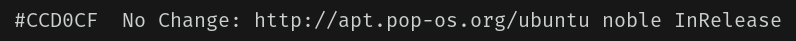
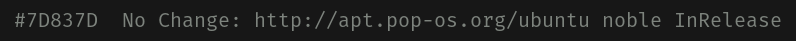
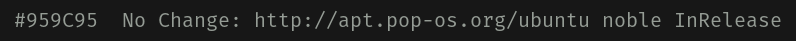
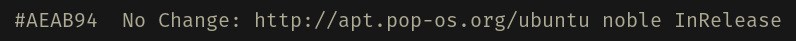
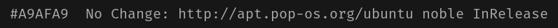
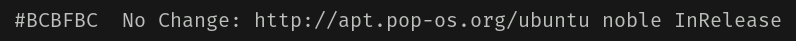

# COSMIC Terminal schemes

Colour schemes for COSMIC Terminal. The desktop `.ron` in `cosmic/` does not
colour ANSI text, so the terminal needs its own import.

1. COSMIC Terminal → **View → Color schemes…** (not Settings → Appearance)
2. **Dark** tab → **Import** → a `.ron` from this folder
3. View → Settings → Appearance → Color scheme (dark) → the scheme name

If a profile is set as default, set the scheme on that profile too or the
dropdown will look like it did nothing. `cosmic/install.sh` selects **Noir**,
so import that one at least.

Every scheme here keeps the 16 ANSI colours of Noir. Only the plain text
colour and the dim text change, so bat, lsd, starship, nala and btop look the
same whichever one you pick. The cursor stays orange `#F25623`.

The `blue` slot is ember `#F56E0F` (bright the same, dim `#B85A1A`), so
nala's `Updated:` and `Downloaded:` labels stand out next to the sage
`No Change:`, the way DarkGold's salmon `blue` does. Directories are not
affected: `LS_COLORS` in `zsh/noir.zsh` colours them in truecolor.

## Which one

Fog `#CCD0CF` is the default and the brightest. At night it can glare, so the
others step down through Noir's own greys. Lower in the list is brighter and
easier to read for long stretches; higher is calmer.

| Scheme | Plain text | Contrast | Also used for |
|--------|------------|----------|---------------|
| Noir Smoke | `#7D837D` | 4.6:1 | muted text, close to the `cyan` slot |
| Noir Sage Grey | `#959C95` | 6.4:1 | directories (`LS_COLORS`) |
| Noir Khaki | `#AEAB94` | 7.7:1 | menu text, the `yellow` slot |
| Noir Ash | `#A9AFA9` | 8.0:1 | none, halfway between grey-sage and pale |
| Noir Pale | `#BCBFBC` | 9.7:1 | the `white` slot |
| **Noir** (default) | `#CCD0CF` | 11.5:1 | the desktop text tint |

When plain text shares a colour with an ANSI slot, output in that slot stops
standing out: directories in Noir Sage Grey, for example, look like plain
text. Orange errors and sage strings stand out more against the dimmer
schemes than against fog.

**Bold:** `bright_foreground` (`#DADEDD`) only colours bold text when
`use_bright_bold` is on. The baseline config in `cosmic/config/` leaves it off,
so bold text is the plain text colour at weight 800.

Previews are rendered in Fira Mono on the theme background `#171717`, not
taken from the terminal. In COSMIC you get Maple Mono at 77% opacity over the
wallpaper, so text looks a little softer and contrast a little lower.

## Dark

**Noir** · `Noir-term.ron` · fog `#CCD0CF`, 11.5:1. The default.

**Noir Smoke** · `Noir-term-smoke.ron` · `#7D837D`, 4.6:1. The dimmest that
still clears 4.5:1 on the background. Good for a low-glare look at night,
tiring for long reading.

**Noir Sage Grey** · `Noir-term-sage-grey.ron` · `#959C95`, 6.4:1. Noir's
grey-sage; plain text matches directories.

**Noir Khaki** · `Noir-term-khaki.ron` · `#AEAB94`, 7.7:1. The warm one,
Noir's menu text colour. Plain text sits close to the `yellow` slot.

**Noir Ash** · `Noir-term-ash.ron` · `#A9AFA9`, 8.0:1. A cool grey halfway
between grey-sage and pale, so it matches no ANSI slot.

**Noir Pale** · `Noir-term-pale.ron` · `#BCBFBC`, 9.7:1. One step below fog.

Contrast is plain text on the theme background, WCAG 2.
